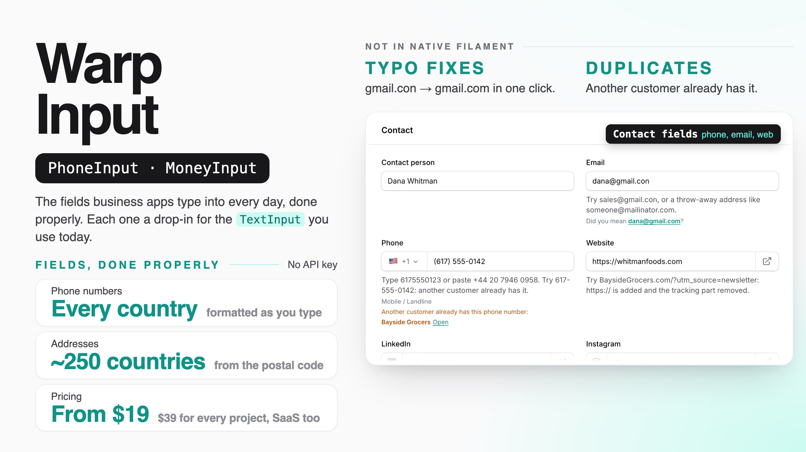

# Warp Input

**The fields business apps type into every day, done properly. Phone numbers for every country, addresses filled in from the postal code, money with tax and rounding, numbers with steppers and pack sizes, records found by initials or reading, character counters that count emoji right, furigana, IDs with check digits (IBAN, VAT, invoice numbers, EAN), numbers in order, signatures and name stamps, barcode scanning, and form-wide helpers like draft recovery, conflict detection and undo — each one a drop-in replacement for the Filament field you use today.**

<a href="https://demo.warpui.com/input"></a>

Type a customer's address from the ZIP code, paste a phone number from an email, fix *gmail.con* with one click, and watch two people edit the same order at once — at **[demo.warpui.com/input](https://demo.warpui.com/input)**. No sign-up needed; the data is reset every hour.



- [What it does](#what-it-does)
- [Installation](#installation)
  - [AI coding assistants (Laravel Boost)](#ai-coding-assistants-laravel-boost)
- [Quick start](#quick-start)
- [Phone numbers](#phone-numbers)
  - [Phone numbers in tables and infolists](#phone-numbers-in-tables-and-infolists)
  - [Validation outside a form](#validation-outside-a-form)
- [Email addresses](#email-addresses)
  - [Email addresses in tables and infolists](#email-addresses-in-tables-and-infolists)
- [Web addresses](#web-addresses)
  - [Social profiles](#social-profiles)
  - [Web addresses in tables and infolists](#web-addresses-in-tables-and-infolists)
- [Duplicate warnings](#duplicate-warnings)
- [Addresses](#addresses)
  - [The address fields](#the-address-fields)
  - [Filling in the address from the postal code](#filling-in-the-address-from-the-postal-code)
  - [Address suggestions while typing](#address-suggestions-while-typing)
  - [Pin on a map](#pin-on-a-map)
  - [Country, state, time zone, currency and language pickers](#country-state-time-zone-currency-and-language-pickers)
  - [Showing addresses](#showing-addresses)
  - [Validation rules](#validation-rules)
  - [Credits](#credits)
- [Money](#money)
  - [Tax](#tax)
  - [Exchange-rate estimates](#exchange-rate-estimates)
- [Numbers and quantities](#numbers-and-quantities)
- [Discounts and fees](#discounts-and-fees)
- [Calculated fields](#calculated-fields)
- [Ratings](#ratings)
- [Table columns and infolist entries](#table-columns-and-infolist-entries)
  - [Totals per currency and per tax rate](#totals-per-currency-and-per-tax-rate)
  - [Validation outside a form](#validation-outside-a-form-1)
- [Choosing a record](#choosing-a-record)
- [Suggestions while typing](#suggestions-while-typing)
- [Recently used values](#recently-used-values)
- [Text fields](#text-fields)
  - [Character counter](#character-counter)
  - [Normalizing](#normalizing)
  - [Furigana](#furigana)
  - [Saved replies (templates)](#saved-replies-templates)
  - [Merge tags](#merge-tags)
  - [Word and personal data warnings](#word-and-personal-data-warnings)
  - [Password](#password)
  - [Methods](#methods)
  - [Validation rules](#validation-rules-1)
  - [Table columns](#table-columns)
  - [Adding your own helpers to the text fields](#adding-your-own-helpers-to-the-text-fields)
- [IDs and numbers](#ids-and-numbers)
  - [The ID field](#the-id-field)
  - [Hiding numbers](#hiding-numbers)
  - [Numbers in order](#numbers-in-order)
  - [Table columns and entries](#table-columns-and-entries)
  - [Validation rule](#validation-rule-1)
- [Signatures](#signatures)
  - [How signatures are saved](#how-signatures-are-saved)
  - [Table column and infolist entry](#table-column-and-infolist-entry)
- [Name stamps (hanko)](#name-stamps-hanko)
- [Barcode and QR scanning](#barcode-and-qr-scanning)
  - [Keep scanning into a repeater](#keep-scanning-into-a-repeater)
  - [Add scanning to your own fields](#add-scanning-to-your-own-fields)
- [Text from a photo (OCR)](#text-from-a-photo-ocr)
  - [Where the text is read](#where-the-text-is-read)
- [Dictation](#dictation)
- [Form helpers](#form-helpers)
  - [Unsaved input (`drafts()`)](#unsaved-input-drafts)
  - [Someone else saved first (`conflicts()`)](#someone-else-saved-first-conflicts)
  - [Enter to the next field (`enterToNext()`)](#enter-to-the-next-field-entertonext)
  - [Required fields still empty (`requiredSummary()`)](#required-fields-still-empty-requiredsummary)
  - [Copy from last time (`copyFromPrevious()`)](#copy-from-last-time-copyfromprevious)
  - [Undo (`undo()`)](#undo-undo)
  - [Paste from a spreadsheet (`spreadsheetPaste()`)](#paste-from-a-spreadsheet-spreadsheetpaste)
- [Multi-tenancy](#multi-tenancy)
- [Testing](#testing)
- [Commands](#commands)
- [Requirements](#requirements)
- [Credits](#credits-1)
- [Support](#support)
- [License](#license)

## What it does

Filament already has a great `TextInput`, `Select` and `Textarea`. Warp Input adds what business forms need on top of them, and only that: nothing here repeats what Filament does on its own (masks, `trim()`, `datalist()`, `revealable()`, `unsavedChangesAlerts()` …).

| You want… | Use |
| --- | --- |
| Phone numbers from any country, saved one way, with mobile-only fields and click-to-call | [`PhoneInput`](#phone-numbers), `PhoneColumn` |
| No more *gmail.con*, throw-away addresses or *https://*-less links | [`EmailInput`](#email-addresses), [`UrlInput`](#web-addresses), `UrlColumn` |
| "This customer already exists" while typing | [`->warnDuplicates()`](#duplicate-warnings) |
| Address fields that follow the country, filled in from the postal code, with a pin on a map | [`AddressFields`](#addresses), `AddressMap`, `AddressColumn` |
| Country, state, time zone, currency and language pickers in the user's language | [`CountrySelect` and friends](#country-state-time-zone-currency-and-language-pickers) |
| Money in the right format for each currency, with tax included or not and rounding rules | [`MoneyInput`](#money), `MoneyColumn`, `MoneySum`, `TaxSummary` |
| Quantities with − / + buttons, units and pack sizes; % or amount discounts; star ratings | [`NumberInput`](#numbers-and-quantities), [`DiscountInput`](#discounts-and-fees), [`RatingInput`](#ratings) |
| *Price × quantity* filled in by itself, and checked again on the server | [`->calculate()`](#calculated-fields) |
| Records found by initials, by reading (kana, romaji) or by code, and added without a modal | [`RecordSelect`](#choosing-a-record) |
| Suggestions from what was typed before, recently used first | [`SuggestInput`](#suggestions-while-typing) |
| Character counters that count emoji as one, full-width as two, bytes or text messages | [`WarpTextInput`, `WarpTextarea`](#text-fields) |
| Half-width / full-width / kana clean-up, furigana from the IME, saved replies and merge tags | [`WarpTextInput`, `WarpTextarea`](#text-fields) |
| Password strength, rules ticked off as you type, and a generate button | [`PasswordInput`](#password) |
| IBAN, VAT, Japanese invoice and corporate numbers, EAN/ISBN, postal codes, card numbers | [`IdInput`](#ids-and-numbers), `IdColumn` |
| *INV-2026-0042*, never twice, even when two people save at once | [`SequenceInput`](#numbers-in-order) |
| `****-1234` until someone allowed to see it clicks | [`->masked()`](#hiding-numbers), `MaskedColumn` |
| Signatures, name stamps (hanko), barcodes and QR codes, text from a photo, dictation | [`SignaturePad`](#signatures), [`StampInput`](#name-stamps-hanko), [`->scan()`](#barcode-and-qr-scanning), [`->scanText()`](#text-from-a-photo-ocr), [`->dictation()`](#dictation) |
| Drafts that survive a closed tab, *someone else saved first*, Enter to the next field, undo, paste from Excel | [`FormAssist`](#form-helpers) |

Every field:

- **is a drop-in replacement.** `PhoneInput` extends `TextInput`, `CountrySelect` extends `Select`, `WarpTextarea` extends `Textarea`. `required()`, `placeholder()`, `disabled()`, `live()`, `unique()` and validation keep working.
- **saves one clean format, checked on the server.** E.164 phone numbers, lower-case email domains, `1234.50` amounts, IBANs without spaces, ISO country codes. The browser only helps people type; values from your API, your tests or a browser without JavaScript are saved the same way.
- **comes with its table column and infolist entry** where that makes sense, and a validation rule you can use outside forms.
- **loads only its own JavaScript, only on pages that use it.** A page with an email field loads 5 KB, not the phone number data or the map.
- **speaks ten languages** (English, Japanese, German, French, Spanish, Italian, Brazilian Portuguese, Korean, simplified and traditional Chinese), with numbers, money and country names written the way each language writes them.
- **works without API keys.** Postal codes, address formats, phone data and disposable-email lists ship with the package or are imported once. Online lookups (VIES, address suggestions, exchange rates) are optional.

## Installation

> **Warp Input is a commercial plugin.** A license is required. After purchase you receive credentials for the private Composer repository.

```bash
composer config repositories.qalainau composer https://qalainau.privato.pub/composer
composer config --auth http-basic.qalainau.privato.pub "your-email" "your-license-key"

composer require qalainau/filament-warp-input
php artisan filament:assets
```

> Run `php artisan filament:assets` again after every update of the package.

Only if you use numbers in order (`SequenceInput`) or recently used values (`rememberRecent()`), run `php artisan migrate` too. It creates two tables, `warp_input_sequences` and `warp_input_recent_values`; your tables are not changed. To edit the migration, publish it first with `php artisan vendor:publish --tag=filament-warp-input-migrations`.

To fill in addresses from postal codes, import the countries you need once (and again from time to time, for example in your deploy script):

```bash
php artisan warp-input:postal-codes JP US
```

The files go to `storage/app/warp-input/postal-codes/` — not into your database. See [Filling in the address from the postal code](#filling-in-the-address-from-the-postal-code).

Set the defaults for a panel (all optional):

```php
use Qalainau\FilamentWarpInput\FilamentWarpInputPlugin;

$panel->plugin(
    FilamentWarpInputPlugin::make()
        ->country('US')                       // phone numbers, addresses and IDs without a country are read as US ones
        ->preferredCountries(['US', 'CA'])    // shown first in country lists
        ->currency('USD')
        ->taxRate(6.25),
);
```

Without the plugin, the fields use the country of the app locale (`APP_LOCALE=pt_BR` → Brazil, Brazilian reais), or the US.

### AI coding assistants (Laravel Boost)

Warp Input ships instructions for AI coding assistants such as Claude Code, Cursor and Codex. If your app uses
[Laravel Boost](https://laravel.com/docs/boost), the assistant learns from them which Warp Input field replaces which Filament field, how each one stores its value, and how to test it.

- **Guidelines** (`resources/boost/guidelines/core.md`): a short summary that Boost adds to `CLAUDE.md`, `AGENTS.md` and the other agent files. It also points the assistant to this README in `vendor/`, so it reads the documentation of the version you have installed.
- **Skill** `warp-input-development` (`resources/boost/skills/`): an example for every field, the table columns, and tests. The assistant loads it when it works on forms.

When `php artisan boost:install` asks "Which third-party AI guidelines/skills would you like to install?", select `qalainau/filament-warp-input`. To do it without the question, add the package to `boost.json` and run the command again:

```json
{
    "packages": ["qalainau/filament-warp-input"]
}
```

```bash
php artisan boost:install --guidelines --skills -n
```

## Quick start

A customer form, before and after:

```php
// Before
TextInput::make('phone')->tel(),
TextInput::make('email')->email(),
TextInput::make('credit_limit')->numeric()->prefix('$'),

// After
use App\Models\Customer;
use Qalainau\FilamentWarpInput\Forms\AddressFields;
use Qalainau\FilamentWarpInput\Forms\EmailInput;
use Qalainau\FilamentWarpInput\Forms\FormAssist;
use Qalainau\FilamentWarpInput\Forms\MoneyInput;
use Qalainau\FilamentWarpInput\Forms\PhoneInput;

FormAssist::make()->drafts()->conflicts(),             // keep what was typed, stop silent overwrites
PhoneInput::make('phone')->warnDuplicates(Customer::class),
EmailInput::make('email')->rejectDisposable(),
AddressFields::make(),                                 // country, postal code → state and city, street
MoneyInput::make('credit_limit'),                      // $12,500.00, saved as 12500.00
```

In the table:

```php
use Qalainau\FilamentWarpInput\Tables\AddressColumn;
use Qalainau\FilamentWarpInput\Tables\MoneyColumn;
use Qalainau\FilamentWarpInput\Tables\PhoneColumn;

PhoneColumn::make('phone'),          // (617) 555-0123, click to call
AddressColumn::make('address'),      // 1 Harbor St, Boston, MA 02110
MoneyColumn::make('credit_limit'),
```

## Phone numbers

`PhoneInput` replaces `TextInput::make('phone')->tel()`. It keeps everything you know from `TextInput` (`required()`, `placeholder()`, `disabled()`, `unique()`, `live()` …) and validates with [libphonenumber](https://github.com/google/libphonenumber), Google's library behind Android's phone number handling.

```php
use Qalainau\FilamentWarpInput\Forms\PhoneInput;

PhoneInput::make('phone')
```

What it does:

- **A country list on the left.** A flag and the calling code (`🇺🇸 +1`). Click it (or press ↓) to search by country name in the user's language, by code (`JP`) or by calling code (`81`). The panel's preferred countries are at the top.
- **Formats while typing**, the way numbers are written in that country: `6175550123` becomes `(617) 555-0123`, `0312345678` becomes `03-1234-5678`. Backspace keeps deleting (the formatting never puts a hyphen back while you delete).
- **Reads what people paste.** `+44 20 7946 0958` switches the country to the UK. Full-width digits (`０９０ー１２３４ー５６７８`), long-vowel dashes, spaces and dots are all read.
- **Extensions.** `ext. 12`, `x12`, `#12` and `内線 12` are kept as an extension.
- **The kind of number.** When the user leaves the field, it shows *Mobile* or *Landline* under the field, and can refuse other kinds (`->types([PhoneType::Mobile])`).
- **One stored format.** Numbers are saved in E.164 (`+16175550123`), so the same number is always the same string: searching, duplicate checks and sending text messages just work. They are shown again the way they are written in the country, and a number from another country is written the same way in the field, in tables and in infolists (`+81 90-1234-5678`).

A complete example:

```php
use App\Models\Customer;
use Qalainau\FilamentWarpInput\Enums\PhoneFormat;
use Qalainau\FilamentWarpInput\Enums\PhoneType;
use Qalainau\FilamentWarpInput\Forms\PhoneInput;

PhoneInput::make('phone')
    ->required()
    ->defaultCountry('US')                   // numbers without +… are read as US numbers
    ->preferredCountries(['US', 'CA', 'MX']) // at the top of the country list
    ->warnDuplicates(Customer::class),       // "Another customer already has this phone number: Acme Corp (Open)"

PhoneInput::make('mobile')
    ->types([PhoneType::Mobile]),            // mobile numbers only

PhoneInput::make('office')
    ->onlyCountries(['US', 'CA'])            // other countries fail validation and are not in the list
    ->storeAs(PhoneFormat::National),        // saved as (617) 555-0123
```

| Method | What it does |
| --- | --- |
| `defaultCountry(string $country)` | The country for numbers typed without a country code (ISO code: `'US'`, `'JP'`). Defaults to the panel's `country()`. |
| `preferredCountries(array $countries)` | Countries at the top of the list. Defaults to the panel's `preferredCountries()`. |
| `onlyCountries(?array $countries)` | Accept numbers from these countries only. |
| `types(array $types)` | Accept these kinds only: `PhoneType::Mobile`, `FixedLine`, `TollFree`, `Voip`, `PremiumRate`, `SharedCost`, `Personal`, `Pager`, `Uan`, `Voicemail`. |
| `storeAs(PhoneFormat $format)` | `PhoneFormat::E164` (default, `+16175550123`), `International` (`+1 617-555-0123`), `National` (`(617) 555-0123`) or `Rfc3966` (`tel:+1-617-555-0123`). |
| `extension(bool $condition = true)` | Accept an extension (on by default). In E.164 it is saved as `+16175550123;ext=12`. |
| `countrySelect(bool $condition = true)` | Show the country list (on by default). Without it, numbers without `+` are read as numbers of the default country. |
| `showType(bool $condition = true)` | Show *Mobile* / *Landline* under the field (on by default). |
| `warnDuplicates(...)` | Warn about other records with the same number. Numbers are compared in E.164, so `(617) 555-0123` finds `+16175550123`. See [Duplicate warnings](#duplicate-warnings). |

**Mobile or landline.** In the US, Canada and a few other countries the number itself doesn't say whether it is a mobile. Those numbers pass both `PhoneType::Mobile` and `PhoneType::FixedLine`, and the field shows *Mobile / Landline*.

**What `$get('phone')` returns.** While the form is open, the state is what the user sees (`(617) 555-0123`). The E.164 form is made when the form is saved (`getState()`). To use the number in your own code before that, call `Phone::format($value, PhoneFormat::E164, 'US')`.

**Filling the field from another field.** `$set('phone', '+81312345678')` (in another field's `afterStateUpdated()`) shows the number the same way as a saved one — `+81 3-1234-5678` with the Japanese flag — and saves it as E.164. The same goes for `IdInput` (an IBAN is grouped) and `MoneyInput` (`$set('total', '1234.5')` shows `1,234.50`). A value copied from another field of the same kind (`$set('billing_phone', $get('phone'))`) is kept as it is.

**Where the work happens.** The browser formats the number while the user types (with [libphonenumber-js](https://gitlab.com/catamphetamine/libphonenumber-js), about 160 KB, loaded only on pages with a phone field). The kind of number and the validation are checked on the server with [libphonenumber-for-php](https://github.com/giggsey/libphonenumber-for-php-lite), the same data in PHP. The server is asked once when the user leaves the field, never while typing.

### Phone numbers in tables and infolists

`PhoneColumn` and `PhoneEntry` show a stored number the way it is written in its country (`(617) 555-0123` for a US number on a US panel, `+81 3-1234-5678` for a Japanese one), and clicking it calls the number.

```php
use Qalainau\FilamentWarpInput\Infolists\PhoneEntry;
use Qalainau\FilamentWarpInput\Tables\PhoneColumn;

PhoneColumn::make('phone')->copyable()->searchable()   // copies +16175550123
PhoneColumn::make('mobile')->linkTo('whatsapp')         // https://wa.me/16175550123
PhoneEntry::make('phone')
```

| Method | What it does |
| --- | --- |
| `country(string $country)` | Numbers of this country are shown in its own format, others with `+`. Defaults to the panel's `country()`. |
| `displayAs(?PhoneFormat $format)` | Always show this format, for example `PhoneFormat::International`. |
| `linkTo(?string $link)` | `'tel'` (default), `'sms'`, `'whatsapp'`, or `null` for no link. |

### Validation outside a form

```php
use Qalainau\FilamentWarpInput\Enums\PhoneType;
use Qalainau\FilamentWarpInput\Rules\Phone;

$request->validate(['phone' => ['required', new Phone(country: 'US', types: [PhoneType::Mobile])]]);
```

The helper `Qalainau\FilamentWarpInput\Support\Phone` works anywhere: `Phone::format('617-555-0123', PhoneFormat::E164, 'US')` returns `'+16175550123'`, `Phone::display('+16175550123', 'US')` returns `'(617) 555-0123'`, `Phone::isValid()`, `Phone::types()` and `Phone::countries('de')` (names in German, with calling codes).

## Email addresses

`EmailInput` replaces `TextInput::make('email')->email()`. It keeps the `email` validation rule and everything else you know from `TextInput` (`required()`, `placeholder()`, `disabled()`, `unique()`, `live()` …).

```php
use Qalainau\FilamentWarpInput\Forms\EmailInput;

EmailInput::make('email')
```

What it does:

- **Typing mistakes.** When the user leaves the field, a typo in a common mail domain gets a one-click fix under the field: *"Did you mean taro@gmail.com?"* for `taro@gmail.con`, `taro@gmial.com`, `taro@gmail.co`, `ann@yahoo.co.jo`, `ken@docomo.ne.jo`. Clicking the address (or pressing Enter on it) puts it in the field. Nothing is changed without the click.
- **Tidy values.** Spaces, full-width characters (`ｔａｒｏ＠ｇｍａｉｌ．ｃｏｍ`) and a leading `mailto:` are removed, and the domain is lower-cased: `Taro.Yamada@Gmail.COM` is saved as `Taro.Yamada@gmail.com`. This also happens on the server before validation, so values from the API, from tests or from a browser without JavaScript are saved the same way.
- **Disposable addresses** (optional). Warn about, or refuse, throw-away addresses such as `mailinator.com`.
- **Duplicates** (optional). Warn when another record already has this address. See [Duplicate warnings](#duplicate-warnings).

A complete example:

```php
use App\Models\Customer;

EmailInput::make('email')
    ->required()
    ->commonDomains(['harborsupply.com'])   // also suggest your own domain
    ->rejectDisposable()                     // refuse mailinator.com and similar
    ->warnDuplicates(Customer::class)        // "Another customer already has this email address: Acme Corp (Open)"
```

| Method | What it does |
| --- | --- |
| `suggestions(bool $condition = true)` | Show typo suggestions (on by default). `->suggestions(false)` turns them off. |
| `commonDomains(array $domains)` | Domains to add to the suggestions, such as your company's or your biggest customers'. They are checked first. |
| `lowercase(bool $condition = true)` | Lower-case the whole address, not only the domain. Off by default, because a few mail servers treat the part before `@` as case-sensitive. |
| `warnDisposable(bool $condition = true)` | Show a warning under the field for a disposable address. The form still saves. |
| `rejectDisposable(bool $condition = true)` | Refuse disposable addresses with a validation error (adds the `NotDisposableEmail` rule). |
| `warnDuplicates(...)` | Warn about other records with the same address. See [Duplicate warnings](#duplicate-warnings). |

**How suggestions are chosen.** The field knows about 120 common mail domains, grouped by country (Gmail, Outlook, iCloud and Yahoo everywhere; `yahoo.co.jp`, `docomo.ne.jp`, `ezweb.ne.jp`, `au.com`, `softbank.ne.jp`, `i.softbank.jp` in Japan; `gmx.de`, `web.de`, `t-online.de` in Germany; `orange.fr`, `free.fr`; `libero.it`; `uol.com.br`, `bol.com.br`; `naver.com`, `daum.net`; `qq.com`, `163.com`, `126.com`, and more). The panel's country (`FilamentWarpInputPlugin::make()->country('JP')`) is checked first. A suggestion is shown when the typed domain is one or two letters away from a known domain (two letters only for longer domains), or when its ending can't exist (`.con`, `.cmo`, `.co.jo`, `.ne.jo`, `.nte`, `.ogr`). Real domains from other countries are left alone (`outlook.it` is not "corrected" to `outlook.jp`), and so are domains the field doesn't know (`harbor.example`). Suggestions are worked out in the browser; nothing is sent to the server.

**Disposable addresses.** The list of about 10,000 disposable domains comes from [disposable-email-domains](https://github.com/disposable-email-domains/disposable-email-domains) (CC0) and ships with the package, so no external service is called. Subdomains count too (`x.mailinator.com`). The list stays on the server: when the user leaves the field, the field asks the server once. To check that a domain can receive mail at all (MX records), add Laravel's `email:dns` rule — Warp Input doesn't do network lookups itself:

```php
EmailInput::make('email')->rule('email:dns')
```

Outside a form, use the rule directly:

```php
use Qalainau\FilamentWarpInput\Rules\NotDisposableEmail;

$request->validate(['email' => ['required', 'email', new NotDisposableEmail]]);
```

The helper class works anywhere: `Email::normalize(' Taro@Gmail.COM ')` returns `'Taro@gmail.com'`, `Email::isDisposable('a@mailinator.com')` returns `true` (`Qalainau\FilamentWarpInput\Support\Email`).

### Email addresses in tables and infolists

Filament's own `TextColumn` and `TextEntry` already do everything an email column needs, so Warp Input doesn't add one:

```php
use Filament\Tables\Columns\TextColumn;

TextColumn::make('email')
    ->url(fn (?string $state): ?string => $state ? "mailto:{$state}" : null)
    ->copyable()
    ->searchable()
```

## Web addresses

`UrlInput` replaces `TextInput::make('website')->url()`. It keeps the `url` validation rule.

```php
use Qalainau\FilamentWarpInput\Forms\UrlInput;

UrlInput::make('website')
```

What it does:

- **Adds `https://`.** Typing `example.com` or `www.example.com/products` gives `https://example.com` and `https://www.example.com/products` when the user leaves the field and again on the server before saving. `http://` addresses stay `http://`.
- **Lower-cases the host** (`Example.COM/About-Us` → `https://example.com/About-Us`). The path and the query keep their letters, because many sites treat them as case-sensitive.
- **Open button.** The button on the right opens the address in a new tab. It is disabled while the text isn't a web address yet.
- **Tracking parameters** (optional): `->stripTracking()` removes `utm_*`, `fbclid`, `gclid`, `msclkid` and similar from the address.
- **Allowed domains** (optional): `->domains(['example.com'])`.
- **Social profiles** (optional): `->social('x')` turns `@warpui` into `https://x.com/warpui`.

```php
UrlInput::make('website')
    ->stripTracking()                        // https://shop.example.com/item?utm_source=news&id=7 → …/item?id=7
    ->warnDuplicates(Customer::class)

UrlInput::make('portal_url')
    ->domains(['harborsupply.com'])          // portal.harborsupply.com is fine, example.com is refused
```

| Method | What it does |
| --- | --- |
| `stripTracking(bool $condition = true)` | Remove tracking parameters: everything starting with `utm_`, and `fbclid`, `gclid`, `gclsrc`, `dclid`, `gbraid`, `wbraid`, `msclkid`, `yclid`, `twclid`, `ttclid`, `li_fat_id`, `mc_cid`, `mc_eid`, `igshid`, `igsh`, `_hsenc`, `_hsmi`, `mkt_tok`, `_ga`, `_gl`, `srsltid` and a few more. Other parameters keep their order and spelling. |
| `domains(array $domains)` | Accept only these domains and their subdomains (`shop.example.com` counts as `example.com`; `evil-example.com` doesn't). Adds the `UrlDomain` rule, and the field warns as soon as the user leaves it. |
| `social(SocialNetwork\|string $network)` | Make the field a profile field for one network (below). |
| `openButton(bool $condition = true)` | Show the open button (on by default). |
| `warnDuplicates(...)` | Warn about other records with the same address (compared after `https://` is added and the host is lower-cased). See [Duplicate warnings](#duplicate-warnings). |

The field uses `type="text"` with `inputmode="url"`, not `type="url"`: with `type="url"` the browser would block the form for `example.com` before the field could add `https://`. Phones still show the keyboard with `.com` and `/`.

### Social profiles

```php
use Qalainau\FilamentWarpInput\Enums\SocialNetwork;

UrlInput::make('x')->label('X')->social('x')
UrlInput::make('instagram')->social(SocialNetwork::Instagram)
UrlInput::make('mastodon')->social('mastodon')
```

People can type the username, paste the profile link, or write the domain and the name — the field saves the profile URL. For X, `@warpui`, `warpui` and `x.com/warpui` are all saved as `https://x.com/warpui` — and so are old Twitter links (`twitter.com/warpui`, `https://twitter.com/warpui?s=20`) that people still have in signatures and bookmarks. The network's logo is shown on the left and the placeholder shows what to type. Anything that isn't a profile of that network (another site, `x.com/home`) gets a notice under the field and a validation error.

| Network | Type | Saved as |
| --- | --- | --- |
| `x` | `@warpui`, `x.com/warpui` (old `twitter.com` links too) | `https://x.com/warpui` |
| `instagram` | `@warp.ui` | `https://www.instagram.com/warp.ui` |
| `linkedin` | `jane-doe` (a person), `company/acme` | `https://www.linkedin.com/in/jane-doe`, `https://www.linkedin.com/company/acme` |
| `github` | `@qalainau` | `https://github.com/qalainau` |
| `facebook` | `acme`, `fb.com/acme`, `facebook.com/profile.php?id=…` | `https://www.facebook.com/acme` |
| `youtube` | `@warpui`, `warpui`, `youtube.com/channel/UC…` | `https://www.youtube.com/@warpui` |
| `tiktok` | `@warpui` | `https://www.tiktok.com/@warpui` |
| `threads` | `@warpui`, `threads.net/@warpui` | `https://www.threads.com/@warpui` |
| `bluesky` | `@warpui` (→ `warpui.bsky.social`), `warpui.com` | `https://bsky.app/profile/warpui.bsky.social` |
| `mastodon` | `@warpui@mstdn.jp`, `https://mstdn.jp/@warpui` | `https://mstdn.jp/@warpui` |

Usernames are read on the server (the same code that validates and saves), so the browser and the saved value always agree. Outside a form, use `SocialNetwork::X->profileUrl('@warpui')` or the `SocialProfile` rule:

```php
use Qalainau\FilamentWarpInput\Rules\SocialProfile;

$request->validate(['x' => [new SocialProfile(SocialNetwork::X)]]);
```

### Web addresses in tables and infolists

`UrlColumn` and `UrlEntry` show the address short — without `https://`, `www.` and a trailing `/` (`example.com/products`) — and open it in a new tab. Profiles of the networks above are shown with the logo and the username (`@warpui`). Copying gives the full URL, and the full URL is shown as a tooltip.

```php
use Qalainau\FilamentWarpInput\Infolists\UrlEntry;
use Qalainau\FilamentWarpInput\Tables\UrlColumn;

UrlColumn::make('website')->copyable()
UrlColumn::make('mastodon')->social('mastodon')
UrlEntry::make('website')
```

| Method | What it does |
| --- | --- |
| `limitUrl(int $limit)` | How many characters of host and path to show before `…` (40 by default). |
| `social(SocialNetwork\|string $network)` | Always read the value as this network. Needed for Mastodon, because any server can host it; other networks are recognised by their domain. |
| `detectSocial(bool $condition = true)` | Show known profiles with logo and username (on by default). `false` always shows the short address. |

Only `http` and `https` addresses become links; anything else (`javascript:…`) is shown as text.

## Duplicate warnings

`EmailInput`, `UrlInput` and `PhoneInput` can warn when another record already has the same value. When the user leaves the field, a notice appears under it:

> Another customer already has this email address: **Acme Corp** Open

It is only a warning: the form still saves. To refuse duplicates, add Laravel's `unique()` rule as well.

```php
use App\Filament\Resources\Customers\CustomerResource;
use App\Models\Customer;
use Illuminate\Database\Eloquent\Builder;

EmailInput::make('email')
    ->warnDuplicates(
        Customer::class,
        'email',                                                         // the column (defaults to the field name)
        label: fn (Customer $record): string => $record->name,
        url: fn (Customer $record): string => CustomerResource::getUrl('edit', ['record' => $record]),
        query: fn (Builder $query): Builder => $query->whereNull('archived_at'),
    )

PhoneInput::make('phone')->warnDuplicates(Customer::class)
UrlInput::make('website')->warnDuplicates(Customer::class)
```

| Argument | What it does |
| --- | --- |
| `$model` | The model to search. |
| `$column` | The column to compare. Defaults to the field name. |
| `label` | The name to show for each record. Defaults to the resource's record title (`$recordTitleAttribute`), then the `name` or `title` attribute, then `#id`. |
| `url` | Where "Open" goes (in a new tab, so the form isn't lost). Defaults to the resource's edit page, or its view page, when the user may edit or view the record. Without a resource, no link is shown. |
| `query` | Narrow the search, for example to leave out archived records. |
| `modelLabel`, `pluralModelLabel` | The words in the notice ("Another **customer** already has…"). Default to the resource's model labels, or the class name. |
| `tenantOwnershipRelationship` | The model's relationship to the tenant, when it differs from the panel's and the model has no resource. |
| `condition` | Turn the warning on or off (`bool` or closure). |

How values are compared:

- **In the saved form.** What the user typed goes through the field's own saving step first, so `０９０ー１２３４ー５６７８` matches a saved `+819012345678`, `Harbor.Example` matches `https://harbor.example`, and `ORDERS@ACME.COM` matches `orders@acme.com`. Email addresses are compared without regard to case on every database (`lower(column) = ?`), because older rows may have been saved with capitals.
- **The record being edited is left out**, so editing a customer never warns about itself.
- **Tenancy.** In a panel with Filament tenancy, only the current tenant's records are searched, through the same ownership relationship Filament's resources use (the resource's `$tenantOwnershipRelationship`, or the panel's). If the model has no such relationship and isn't excluded from tenancy (`$isScopedToTenant = false` on its resource), no duplicates are shown at all rather than showing other tenants' records — pass `tenantOwnershipRelationship:` to fix that.
- At most three records are named; the notice says "and 2 more" for the rest.
- The search runs once when the user leaves the field, not while typing. Add an index to the column on large tables.

The warning is a trait, `Qalainau\FilamentWarpInput\Forms\Concerns\WarnsAboutDuplicates`, so other Warp Input text fields can offer it too.

## Addresses

Business apps type addresses all day: customers, suppliers, ship-to addresses. Each country writes them differently, and a single "Address" textarea makes them impossible to search, sort or print on a label. Warp Input gives you one address block that changes with the country, fills itself in from the postal code, can drop a pin on a map, and saves every part in its own column.

### The address fields

`AddressFields` is a layout component, like Filament's `Fieldset`. Pick a country and the fields inside change to match how that country writes addresses: the order, the labels, which parts are required and the postal code format. About 250 countries and territories are covered.

| Country | Fields, in order |
| --- | --- |
| United States | Street address · Apartment, suite… · City · State · ZIP code |
| Japan | 〒 Postal code · Prefecture · City · Town and block number · Building name and room number |
| United Kingdom | Street address · Apartment… · Town or city · Postal code (no state) |
| Germany | Street address · Apartment… · Postal code · City |
| Brazil | Street address · Apartment… · Neighborhood (if you turn it on) · City · State · CEP |

```php
use Qalainau\FilamentWarpInput\Forms\AddressFields;

public static function form(Schema $schema): Schema
{
    return $schema->components([
        TextInput::make('name')->required(),

        AddressFields::make('Billing address')
            ->required()      // the parts this country needs are required
            ->map(),          // a map to drop a pin on (latitude, longitude)

        AddressFields::make('Shipping address')
            ->json('shipping_address'),   // all parts in one JSON column
    ]);
}
```

Each part is saved in its own column. The default column names are the same as a Stripe address, so most tables already fit:

```php
Schema::create('customers', function (Blueprint $table) {
    $table->id();
    $table->string('name');
    $table->string('country', 2)->nullable();      // ISO 3166-1 alpha-2: US, JP
    $table->string('postal_code')->nullable();     // 02110, 100-0001, SW1A 1AA
    $table->string('state')->nullable();           // MA, 東京都
    $table->string('city')->nullable();
    $table->string('line1')->nullable();           // street and number
    $table->string('line2')->nullable();           // apartment, suite, building
    $table->decimal('latitude', 10, 7)->nullable();   // only with ->map()
    $table->decimal('longitude', 10, 7)->nullable();
    $table->json('shipping_address')->nullable();     // only with ->json()
});
```

Your columns have other names? Name each part:

```php
AddressFields::make()
    ->country('country_code')
    ->postalCode('zip')
    ->region('prefecture')
    ->locality('city')
    ->line1('street')
    ->line2('building')
    ->district('neighborhood');   // off by default (Brazil's bairro, Korea's dong, Mexico's colonia)
```

| Method | What it does | Default |
| --- | --- | --- |
| `country(?string $column)` | The country column. `null` hides the country picker and always uses `defaultCountry()`. | `'country'` |
| `postalCode(?string $column)` | The postal code column. | `'postal_code'` |
| `region(?string $column)` | The state, province or prefecture column. | `'state'` |
| `locality(?string $column)` | The city or town column. | `'city'` |
| `district(?string $column)` | A neighborhood or district column. Only shown for countries that write one. | `null` (off) |
| `line1(?string $column)` / `line2(?string $column)` | The street lines. `null` leaves the part out. | `'line1'` / `'line2'` |
| `json(string $column)` | Save all parts in one JSON column instead. Cast it to `array` on the model. The keys are the column names above. | off |
| `defaultCountry(string $country)` | The country for new records, or the only one when `country(null)`. | the panel's `country()` |
| `onlyCountries(array $countries)` | The countries people can pick. | all |
| `preferredCountries(array $countries)` | Countries at the top of the list. | the panel's `preferredCountries()` |
| `storeRegionAs(RegionFormat $format)` | How the state is saved: `RegionFormat::Code` (`MA`, `東京都`, `ON`), `Name` (`Massachusetts`), `Iso` (`US-MA`, `JP-13`). | `Code` |
| `required(bool $condition = true)` | The parts the country needs are always required. | see below |
| `map(bool $condition = true, string $latitude = 'latitude', string $longitude = 'longitude')` | Add a map to drop a pin on. | off |
| `postalCodeLookup(bool $condition = true)` | Fill in the address from the postal code. | on |
| `suggestions(bool $condition = true)` | Suggest addresses while typing the street (needs a search service, see below). | on |

**How it behaves**

- **Required parts follow the country.** With `->required()`, a US address needs the street, city, state and ZIP; a UK address needs the street, town and postcode, and has no state at all. Without `->required()` the address can stay empty, but once someone types any part, the parts that country needs become required. An address left empty saves `null` in every column, the country too.
- **Changing the country** redraws the fields in the new order. A state that does not exist in the new country is cleared, and so are the postal code, city and district of the old country; the street lines are kept, since they take the longest to type. Parts the new country does not use are saved as `null`, so a German address never keeps an old US state or ZIP code.
- **Postal codes are saved the way the country writes them**: `１０００００１` becomes `100-0001`, `sw1a1aa` becomes `SW1A 1AA`, `021101234` becomes `02110-1234`. A code in the wrong shape fails validation with an example: "Enter the ZIP code the way it is written in United States, for example 95014."
- **States are picked from a list** where the country has one (US states, Canadian provinces, Japanese prefectures, Brazilian states and about 40 more). Names are shown in the screen's language: an English screen shows "Tokyo", a Japanese screen shows "東京都"; both save `東京都`. A state saved earlier in another form (`Massachusetts`, `US-MA`) is read and saved again in the chosen form.
- **Two address blocks on one form** (billing and shipping) never mix: postal code answers, suggestions and the map belong to their own block.

### Filling in the address from the postal code

Type a postal code and Warp Input fills in the state, city and, in Japan, the town. Fields that already have a value are never overwritten. When one code covers several places (common in Japan), the parts they share are filled in and a list asks which one; it works with the arrow keys and Enter.

The data is not stored in your database. One command writes small JSON files, one per first three characters of the code, and a lookup reads only one of them:

```bash
php artisan warp-input:postal-codes JP US GB
```

| Country | Source | What it fills |
| --- | --- | --- |
| Japan (`JP`) | Japan Post's KEN_ALL (UTF-8) | prefecture, city, town (and kana readings, via `PostalCodeLookup`) |
| Other countries | GeoNames postal codes (about 100 countries) | state, city, and the map's position |

Run it once when you deploy, and again now and then (Japan Post updates its file monthly). Japan Post's notes such as 「以下に掲載がない場合」 and 「（次のビルを除く）」 are removed, so the town field gets 千代田, not a note. Use `--from=/path/to/file.zip` to import a file you downloaded yourself, and `--geonames` to use GeoNames for Japan too (it has coordinates but no kana).

The files go to `storage/app/warp-input/postal-codes/<country>/`. To keep them elsewhere, for example on S3 so every server shares them:

```php
FilamentWarpInputPlugin::make()
    ->postalCodeStorage(disk: 's3', path: 'warp-input/postal-codes')
```

For countries without files, you can ask an online service instead. None is used unless you turn it on:

```php
FilamentWarpInputPlugin::make()
    ->postalCodeDrivers(['viacep', 'zippopotam'])   // asked in this order
```

| Driver | Countries | Notes |
| --- | --- | --- |
| `'viacep'` | Brazil | Also fills the street and neighborhood. |
| `'zippopotam'` | About 60 | No key needed. |
| your class | any | Implement `Qalainau\FilamentWarpInput\Support\Addresses\Contracts\PostalCodeDriver`. |

Lookups are asked from the server, only after typing pauses for 0.3 seconds or when the field loses focus, and answers are cached for a day.

You can also look up codes in your own code:

```php
use Qalainau\FilamentWarpInput\Support\Addresses\PostalCodeLookup;

app(PostalCodeLookup::class)->lookup('JP', '100-0001');
// [['postal_code' => '100-0001', 'region' => '東京都', 'locality' => '千代田区', 'line1' => '千代田',
//   'kana' => ['トウキョウト', 'チヨダク', 'チヨダ'], 'latitude' => null, 'longitude' => null, 'district' => null]]
```

#### The address in one column

Many apps keep the address in one column (`address`) next to the postal code, without the separate fields of `AddressFields`. Point the postal code at that column with `fillAddress()`:

```php
use Filament\Forms\Components\TextInput;
use Qalainau\FilamentWarpInput\Forms\PostalCodeInput;

PostalCodeInput::make('postal_code')->fillAddress('address'),
TextInput::make('address'),
```

- Typing `100-0001` puts 「東京都千代田区千代田」 into `address`, and the user goes on with the street number (「1-1」). In other countries the address is written the country's way on one line (`02110` gives `Boston, MA`).
- Only an empty `address` is filled. An address someone already typed is never overwritten, even when the postal code changes.
- When one code covers several places, a list asks which one, as in `AddressFields`.
- The name is the field's name in the same form, like `$set()`: `'address'`, or `'../address'` from inside a repeater.
- It needs the same postal code files or `postalCodeDrivers()` as `AddressFields`.

Every `PostalCodeInput`, with or without `fillAddress()`, turns full-width digits into half-width and adds the country's separator while you type (「１０００００１」 becomes `100-0001`), and stores the code that way.

### Address suggestions while typing

With a search service set on the panel, typing in the street field shows matching addresses from the chosen country. When the city or postal code is already filled in (for example from the postal code lookup), the search uses them too, so `100 Summer St` lists the one in Boston instead of the same street in other towns; if nothing matches them, the typed words alone are searched. Picking one fills in every part (and the map pin). Off by default:

```php
FilamentWarpInputPlugin::make()
    ->addressSuggestions('photon')   // komoot's Photon, OpenStreetMap data, no key
```

Requests go from your server with your app's name as the User-Agent, at most one every half second per server, as the services ask. Photon's public server is free for reasonable use; for heavy use, pass your own server: `->addressSuggestions(new Photon('https://photon.example.com'))`. Nominatim's public server does not allow suggestions while typing, so only use `new Nominatim('https://your-nominatim')` here with your own server.

### Pin on a map

`->map()` adds a map below the address (Leaflet with OpenStreetMap tiles, no key). Click the map to drop a pin, drag the pin to move it. The position is saved in `latitude` and `longitude`, the same columns [Warp Map](https://warpui.com)'s `HasLocation` reads, so the customer shows up on your Warp Map right away.

- After a postal code lookup the map moves to that area (for GeoNames countries). Picking an address suggestion drops the pin exactly.
- With a geocoder, a "Find the address on the map" button moves the pin to the typed address, and **clicking the map fills in the address of that place** (street, city, state and postal code, written the way that country writes them; the second line — apartment or building — is kept). Nominatim and Photon both do this:

  ```php
  FilamentWarpInputPlugin::make()->geocoder('nominatim')   // OpenStreetMap's Nominatim, one request per second
  ```

- Keyboard users can move the map with the arrow keys and press "Put the pin in the middle".
- Use other tiles (your own tile server or a paid service) for heavy traffic: `->mapTiles('https://tiles.example.com/{z}/{x}/{y}.png', '&copy; OpenStreetMap contributors')`.
- The map's script (Leaflet, about 160 KB) is only loaded on pages that show a map.

With `->json()`, the latitude and longitude are saved inside the JSON too.

### Country, state, time zone, currency and language pickers

Five `Select` fields that you can use on their own. They are Filament `Select`s, so `required()`, `live()`, `multiple()`, `disabled()` and the rest work as usual. Names are shown in the screen's language, and you can search in other ways too.

```php
use Qalainau\FilamentWarpInput\Forms\CountrySelect;
use Qalainau\FilamentWarpInput\Forms\CurrencySelect;
use Qalainau\FilamentWarpInput\Forms\LanguageSelect;
use Qalainau\FilamentWarpInput\Forms\RegionSelect;
use Qalainau\FilamentWarpInput\Forms\TimezoneSelect;

CountrySelect::make('country')->live(),                    // 🇯🇵 Japan — saves 'JP'
RegionSelect::make('state')->countryField('country'),      // follows the country field
TimezoneSelect::make('timezone'),                          // (UTC+09:00) Japan Time · 2:32 PM
CurrencySelect::make('currency'),                          // 🇯🇵 JPY — Japanese Yen (¥)
LanguageSelect::make('locale')->locales(['en', 'ja', 'pt_BR']),   // Japanese — 日本語
```

| Field | Shows | Search by | Top of the list | Saves |
| --- | --- | --- | --- | --- |
| `CountrySelect` | flag and name | English name, the country's own name, code, romanized name ("Japan", "日本", "JP", "Nihon") | the panel's `preferredCountries()` | `JP` |
| `RegionSelect` | name in the screen's language | code, local name, Latin name, ISO code | — | `RegionFormat::Code` by default (`storeAs()`) |
| `TimezoneSelect` | UTC offset, name, the time now, grouped by continent | ID (`Asia/Tokyo`), city, country, abbreviation (`JST`, `EST`) | the panel country's zones (`preferredTimezones()`) | `Asia/Tokyo` |
| `CurrencySelect` | flag, code, name, symbol (currencies in use today) | code, English name, symbol | the panel's currency and those of its preferred countries (`preferredCurrencies()`) | `JPY` |
| `LanguageSelect` | name and its own name | code, English name | the app's language and English (`preferredLanguages()`) | `ja`, `pt_BR` |

`CountrySelect::onlyCountries([...])`, `CurrencySelect::onlyCurrencies([...])` and `LanguageSelect::locales([...])` limit the list. `RegionSelect::country('US')` uses a fixed country instead of a field.

### Showing addresses

`AddressColumn` and `AddressEntry` show an address the way its country writes it. Map the columns like `AddressFields` (or `->json()`).

```php
use Qalainau\FilamentWarpInput\Infolists\AddressEntry;
use Qalainau\FilamentWarpInput\Infolists\CountryEntry;
use Qalainau\FilamentWarpInput\Tables\AddressColumn;
use Qalainau\FilamentWarpInput\Tables\CountryColumn;

AddressColumn::make('address')->searchable(['line1', 'city', 'postal_code']),
// 200 Atlantic Ave, Suite 4, Boston, MA 02110
// 〒100-0001 東京都千代田区 千代田1-1 千代田ビル5F

CountryColumn::make('country'),           // 🇯🇵 Japan   (->flagOnly() for narrow tables)

AddressEntry::make('billing'),            // one line per row of the country's format
AddressEntry::make('shipping_label')
    ->style('label')                      // a mailing label
    ->recipient('contact_name')
    ->organization('name')
    ->copyable(),
```

| Style | Use | Example |
| --- | --- | --- |
| `'one-line'` (column default) | tables | `200 Atlantic Ave, Boston, MA 02110` |
| `'multiline'` (entry default) | detail pages | `200 Atlantic Ave` / `Boston, MA 02110` |
| `'label'` | mailing labels: name and company, the country's capital-letter rules, the country name for mail abroad | `Anna Schmidt` / `Hauptstraße 5` / `10115 BERLIN` / `GERMANY` |

The country name is added only when the address is in another country than the panel's. `->showCountry()` / `->showCountry(false)` decides yourself. Japanese, Chinese and Korean addresses written in Latin letters use the Latin order (small to large).

The same formatting is available anywhere:

```php
use Qalainau\FilamentWarpInput\Support\Address;

Address::format([
    'line1' => '200 Atlantic Ave', 'line2' => 'Suite 4',
    'locality' => 'Boston', 'region' => 'MA', 'postal_code' => '02110', 'country' => 'US',
], style: 'one-line');
// 200 Atlantic Ave, Suite 4, Boston, MA 02110
```

The keys are `country`, `postal_code`, `region`, `locality`, `district`, `line1`, `line2`, and for labels `recipient` and `organization`.

### Validation rules

`AddressFields` validates by itself. For API requests or other fields:

```php
use Qalainau\FilamentWarpInput\Rules\AddressPostalCode;
use Qalainau\FilamentWarpInput\Rules\AddressRegion;

$request->validate([
    'postal_code' => [new AddressPostalCode($request->country)],   // 02110, 100-0001, SW1A 1AA
    'state' => [new AddressRegion($request->country)],             // MA, Massachusetts or US-MA
]);
```

Countries without postal codes (Hong Kong, the UAE…) or without a state list accept any value.

### Credits

- Address formats: [Google's address data](https://chromium-i18n.appspot.com/ssl-address/data) (libaddressinput), CC BY 4.0. Refresh with `node bin/fetch-address-data.mjs`.
- Japanese postal codes: [Japan Post](https://www.post.japanpost.jp/zipcode/dl/utf-zip.html), free to use.
- Other postal codes: [GeoNames](https://www.geonames.org), CC BY 4.0.
- Map: [Leaflet](https://leafletjs.com) (BSD-2-Clause) and [OpenStreetMap](https://www.openstreetmap.org/copyright) contributors (ODbL). Address search: [Photon](https://photon.komoot.io) by komoot and [Nominatim](https://nominatim.org).

## Money

`MoneyInput` replaces a `TextInput` for amounts. Everything you know from `TextInput` keeps working (`required()`, `minValue()`, `maxValue()`, `placeholder()`, `disabled()`, `live()` …). Validation runs on the number, so `minValue(0)` works even though the field shows `1,234.50`.

```php
use Qalainau\FilamentWarpInput\Forms\MoneyInput;

MoneyInput::make('price')->currency('USD')
```

What it does:

- **Groups digits as you type**, the way the screen's locale writes numbers: `1,234,567.89` in English, `1.234.567,89` in German, `1 234 567,89` in French, `12,34,567.00` in Indian English.
- **Uses the currency's decimal places**: 0 for JPY and KRW, 2 for USD and EUR, 3 for KWD and BHD (from ICU, the same data PHP's `intl` uses). When the user leaves the field, the amount is rounded and padded: `12.5` becomes `12.50`, `1234.5` yen becomes `1,235`.
- **Shows the symbol on the right side** for the locale: `$ 12.50` in English, `12,50 €` in German.
- **No full-width digits from a Japanese, Chinese or Korean keyboard.** Money, number and discount fields (and number-only IDs and postal codes) are `type="tel"`: the browser turns the input method off on desktop and shows the number pad on phones (`inputmode` alone does nothing on desktop). Autofill is off, so the browser does not suggest phone numbers. Pass `->type('text')` to change it. Typing `3万` then needs the input method; pasting it still works.
- **Reads what people actually type and paste**: full-width digits (`１２３４`), a German amount pasted into an English screen (`1.234,56`), currency symbols (`$1,200`), negative amounts (`-5`, `(5)`, `▲5`), and short forms in the screen's language — `1.5k`, `2.5M` and `3 bn` in English; `3万`, `1.5万円`, `1億2000万` in Japanese; `2,5 Mio.` and `3 Tsd.` in German; `3만` in Korean, `3万` in Chinese, `mil`, `mila`, `mln` and others. Short forms of other languages are not read (`3万` on an English screen is refused), and a lower-case `m` is never read as a million.
- **Saves a clean value** on the server, even when the browser's JavaScript didn't run: a decimal string with the currency's places (`'1234.50'`, fits a `decimal(12, 2)` column) or, with `storeAsMinorUnits()`, an integer of cents (`123450`).

A complete example — an amount in the currency chosen in another field, saved in cents:

```php
use Filament\Forms\Components\Select;
use Qalainau\FilamentWarpInput\Enums\Rounding;

Select::make('currency')->options(['USD' => 'US dollar', 'EUR' => 'Euro', 'JPY' => 'Yen'])->live(),

MoneyInput::make('amount_cents')
    ->currencyField('currency')     // digits and symbol change as soon as the currency changes
    ->storeAsMinorUnits()           // 1,234.56 USD is saved as 123456, 1,235 JPY as 1235
    ->rounding(Rounding::HalfEven)
    ->minValue(0)
    ->required()
```

| Method | What it does |
| --- | --- |
| `currency(string $code)` | ISO 4217 code (`'USD'`, `'JPY'`). When not set: `currencyField()`, then the panel's `currency()`, then the currency of the panel's country. |
| `currencyField(string $field)` | Read the currency from another field of the form. Inside a repeater the name is relative to the row; use `'../../currency'` for a field outside the repeater. When it changes, the field asks the server once for the new digits and symbol and re-rounds the amount. |
| `storeAsMinorUnits(bool $condition = true)` | Save an integer of the smallest unit (cents) instead of a decimal string. Stored values are read back the same way. |
| `rounding(Rounding $rounding)` | `Rounding::Down`, `HalfUp` (default), `Up` or `HalfEven`. Used for saving and for tax. `Down` moves towards zero and `Up` away from zero, also for negative amounts. Panel default: `->rounding()` on the plugin. |
| `tax(?float $rate = null, bool $included = false)` | Tax on the amount. See [Tax](#tax). |
| `taxRateField(string $field)` | Read the tax rate (%) from another field, such as a Select with 8% and 10%. |
| `taxToggle(bool $condition = true)` | The "Incl. tax / Excl. tax" switch next to the field (on when `tax()` is set). |
| `netField()`, `grossField()`, `taxField()` | Also save the amount before tax, with tax, or the tax to other columns of the same model. |
| `showConverted(?string $currency)` | Show an estimate in another currency under the field. See [Exchange-rate estimates](#exchange-rate-estimates). |
| `calculate(string $formula)` | Fill the field from other fields. See [Calculated fields](#calculated-fields). |

**Saved values.** Decimal strings always have the currency's decimal places (`'12.00'`, `'1235'` for yen, `'1.500'` for KWD). The rounding happens on the server before validation and saving, so values from the API or tests are saved the same way as typed ones. Values you put into the form from PHP (`$set('total', 12.5)`, `->default(12.5)`, a model attribute `'1234.50'`) are read as numbers, not as text in the screen's locale.

**What `$get()` returns.** Like Filament's own `mask()`, the form state holds what the user sees (`'1,234.50'`). To work with the number in your own closures, parse it the same way the field does:

```php
use Qalainau\FilamentWarpInput\Support\Numbers;

$amount = Numbers::parse($get('price'), Numbers::symbols(app()->getLocale()));   // '1234.5' or null
```

Most of the time you don't need this: use [`calculate()`](#calculated-fields) instead.

### Tax

```php
MoneyInput::make('price')
    ->tax(rate: 6.25)                // the column holds the amount before tax
    ->netField('price_net')
    ->taxField('price_tax')
    ->grossField('price_gross')
```

A small "Excl. tax" button sits next to the amount. The user can switch it to say that the number they typed already includes tax; under the field they see the other side: *"With tax $106.25 · Tax (6.25%) $6.25"*. When saving:

- The field's own column always holds the amount the way `tax()` says: before tax when `included: false`, with tax when `included: true` — whichever way the user typed it. `included` is also where the switch starts.
- `netField()`, `grossField()` and `taxField()` receive the other values. The tax is rounded with the field's rounding, and the other value is worked out by subtraction, so net + tax always equals gross.
- The switch itself is not saved (it lives in the form state as `<name>__tax` and is removed before saving).

Japanese consumption tax, with the rate chosen per line and the tax rounded down:

```php
Select::make('tax_rate')->options(['10' => '10%', '8' => '8% (food)'])->default('10'),

MoneyInput::make('amount')
    ->currency('JPY')
    ->tax(included: true)
    ->taxRateField('tax_rate')
    ->rounding(Rounding::Down)
    ->netField('amount_net')
    ->taxField('amount_tax')
```

The panel can set a default rate and rounding for every field:

```php
FilamentWarpInputPlugin::make()->currency('JPY')->taxRate(10)->rounding(Rounding::Down)
```

For the totals per tax rate that an invoice needs (*"10%: ¥10,000, tax ¥1,000"*), use [`TaxSummary`](#totals-per-currency-and-per-tax-rate) in the table.

### Exchange-rate estimates

```php
MoneyInput::make('price')->currency('JPY')->showConverted('USD')
```

Under the field: *"About $8.21 at the ECB rate of Nov 6, 2026. This is only an estimate."* The saved value doesn't change. The rate is asked from the server once per currency, after the user stops typing for 0.3 s — never on every key. The server gets it from the European Central Bank's reference rates via [Frankfurter](https://frankfurter.dev) (free, no key) and caches it for 6 hours (failures for 10 minutes). The ECB publishes about 30 currencies once per working day; for others (such as KWD) no estimate is shown.

To use your own rates (an internal table, a paid API), implement `ExchangeRates`; to turn estimates off everywhere, so the server never calls out:

```php
use Qalainau\FilamentWarpInput\Support\ExchangeRates\ExchangeRate;
use Qalainau\FilamentWarpInput\Support\ExchangeRates\ExchangeRates;

class TreasuryRates implements ExchangeRates
{
    public function rate(string $from, string $to): ?ExchangeRate
    {
        $row = DB::table('fx_rates')->where('from', $from)->where('to', $to)->latest('date')->first();

        return $row ? new ExchangeRate((float) $row->rate, $row->date, 'Treasury') : null;
    }
}

FilamentWarpInputPlugin::make()->exchangeRates(new TreasuryRates)
FilamentWarpInputPlugin::make()->exchangeRates(false)   // no estimates, no network
```

## Numbers and quantities

`NumberInput` replaces `TextInput::make('quantity')->numeric()`. `step()`, `minValue()`, `maxValue()`, `required()` and `live()` work as usual.

```php
use Qalainau\FilamentWarpInput\Forms\NumberInput;

NumberInput::make('quantity')->minValue(1)->unit('pcs')
```

- **− and + buttons.** Hold a button to keep counting; it speeds up the longer you hold. They follow `step()` (default 1) and stop at `minValue()` / `maxValue()`.
- **Keyboard.** ↑ and ↓ change the value by one step, Shift + ↑/↓ by ten. Screen readers hear the field as a spin button with its current value, minimum and maximum.
- **Grouping and reading** work like the money field: `12,000`, full-width digits, `1.5k`, `3万` on a Japanese screen.
- **Units**: one unit as text on the right, or a choice of units.

```php
use Qalainau\FilamentWarpInput\Enums\PackSizeRounding;

NumberInput::make('cases')
    ->minValue(0)
    ->unit('pcs')
    ->packSize(12)                                    // 30 becomes 36: "Sold in packs of 12, so this was changed to 36."

NumberInput::make('weight')
    ->unit(['lb' => 'lb', 'kg' => 'kg'])              // the chosen unit is saved to weight_unit
    ->decimals(2)
    ->step(0.5)

NumberInput::make('bags')->packSize(10, PackSizeRounding::Warn)   // only a warning, the value stays
```

| Method | What it does |
| --- | --- |
| `buttons(bool $condition = true)` | The − and + buttons. Without them, ↑ and ↓ still work. |
| `unit(string\|array $unit)` | `'pcs'` shows one unit. A list (`['kg', 'g']` or `['kg' => 'Kilograms', …]`) shows a small select; the chosen unit is saved to `unitField()`. |
| `unitField(string $field)` | The column for the chosen unit. Default: `<name>_unit`. A new record starts with the first unit. |
| `decimals(?int $decimals)` | Round to this many places and always show them (`2` → `1.50`). Without it, the number is kept as typed. |
| `packSize(int\|float $size, PackSizeRounding $rounding = Up)` | Keep the quantity in whole packs. `Up` (`30` → `36`), `Down` (`30` → `24`, never below one pack) or `Warn` (only a note under the field). The server applies `Up` and `Down` again before saving. |
| `calculate(string $formula)` | See [Calculated fields](#calculated-fields). |

Saved values are numbers: an `int` for whole numbers and a `float` otherwise.

## Discounts and fees

`DiscountInput` takes either a percentage or an amount. Switch with the `%` / `$` buttons on the right (the typed value is converted), or simply type `10%`. Under the field the other side appears: *"= $41.10"* or *"= 10% of $411.00"*.

```php
use Qalainau\FilamentWarpInput\Forms\DiscountInput;

DiscountInput::make('discount')
    ->of('subtotal')                    // the amount the percentage applies to
    ->currency('USD')
    ->percentField('discount_percent')  // also save the percentage
```

| Method | What it does |
| --- | --- |
| `of(string $field)` | The field holding the base amount (it may be a calculated field). Relative to a repeater row, like `currencyField()`. |
| `currency()`, `currencyField()`, `rounding()` | As on `MoneyInput`. The amount of a percentage is rounded to the currency. |
| `storeAs(DiscountType $type)` | What the field's own column holds: `DiscountType::Amount` (default, `'41.10'`) or `DiscountType::Percent` (`10.0`). |
| `percentField()`, `amountField()` | Also save the percentage or the amount to other columns. |
| `defaultType(DiscountType $type)` | How an empty field starts (default: percentage). |
| `maxPercent(?float $percent)` | Highest percentage (default 100). Pass `null` for fees that may go above 100%. Negative values are refused. |

In a formula, a `DiscountInput` is read as its amount: `subtotal - discount` works whether the user typed `10%` or `41.10`.

## Calculated fields

`calculate()` on `MoneyInput` or `NumberInput` fills the field from other fields. It is recalculated in the browser as soon as any field it uses changes — no round trip to the server, so typing stays fast. Before saving, the server calculates it again with the same formula and its own values, so a changed value in the browser is never saved.

```php
use Filament\Forms\Components\Repeater;

Repeater::make('lines')->relationship()->schema([
    TextInput::make('description'),
    MoneyInput::make('unit_price'),
    NumberInput::make('quantity'),
    MoneyInput::make('amount')->calculate('unit_price * quantity'),   // the same row
]),

MoneyInput::make('subtotal')->calculate('sum(lines.amount)'),       // all rows
DiscountInput::make('discount')->of('subtotal'),
MoneyInput::make('tax')->calculate('round((subtotal - discount) * 6.25 / 100, 2)'),
MoneyInput::make('total')->calculate('subtotal - discount + tax'),
```

What a formula can contain:

| | |
| --- | --- |
| Numbers | `12`, `0.0625` (always with a `.`) |
| Field names | `price`. In a repeater row, the fields of the same row. `../rate` for a field one level up, as in Filament's `$get()`. Nested state paths such as `address.zip` work too. |
| Operators | `+`, `-`, `*`, `/` (also `×` and `÷`), brackets, a leading minus |
| `round(x)`, `round(x, 2)` | Round half up to whole numbers or to 2 places |
| `min(a, b, …)`, `max(a, b, …)` | Smallest / largest — `max(subtotal - discount, 0)` |
| `sum(lines.amount)` | The total of one column of a repeater (rows with an empty value are skipped) |

- Empty fields count as 0, but when every field the formula uses is empty, the result is empty too (a new row doesn't show `$0.00`).
- Division by zero gives an empty result instead of an error.
- The result is rounded like a typed value: to the currency for `MoneyInput`, to `decimals()` for `NumberInput`.
- Calculated fields are read-only. Call `->readOnly(false)` after `calculate()` to let people type over the value; it is still recalculated when saved.
- The formula is read by the package's own parser — nothing is passed to `eval()`. A formula it can't read throws an `InvalidArgumentException` when the form is built, so mistakes show up during development.
- Calculations use floating-point numbers; results are cleaned to 15 significant digits before rounding (`0.1 + 0.2` is `0.3`), which is far beyond the cents of any real amount.

## Ratings

`RatingInput` is a star rating that can also be hearts, numbers or faces.

```php
use Qalainau\FilamentWarpInput\Enums\RatingStyle;
use Qalainau\FilamentWarpInput\Forms\RatingInput;

RatingInput::make('rating')->allowHalf()
RatingInput::make('recommend')->style(RatingStyle::Numbers)->max(10)
RatingInput::make('delivery')->style(RatingStyle::Faces)
```

- Click a star to choose it; click it again to clear the rating (`clearable(false)` to keep a value).
- With `allowHalf()`, the left half of a star chooses x.5.
- Keyboard: Tab to the rating, then ← → (or ↑ ↓) move by one step (half a step with `allowHalf()`), Home and End go to the lowest and highest, 1–9 jump to that value, Delete, Backspace or 0 clear it.
- Screen readers hear a slider with the value as text: *"3.5 out of 5"*, and for faces *"Happy (4 out of 5)"*.

| Method | What it does |
| --- | --- |
| `max(int $max)` | Number of steps, 1–10 (default 5). Faces always have 5. |
| `style(RatingStyle $style)` | `Stars` (default), `Hearts`, `Numbers` or `Faces` |
| `allowHalf(bool $condition = true)` | Half steps, for stars and hearts |
| `clearable(bool $condition = true)` | Clear by choosing the same value again (default on) |
| `color(string $color)` | Fill colour as CSS (`'#f59e0b'`). Default: amber stars, red hearts, the panel colour for numbers. |

Saved values are numbers (`4`, `3.5`) or `null`. Values outside the range or between steps (`3.3`) fail validation.

## Table columns and infolist entries

```php
use Qalainau\FilamentWarpInput\Infolists\MoneyEntry;
use Qalainau\FilamentWarpInput\Infolists\RatingEntry;
use Qalainau\FilamentWarpInput\Tables\MoneyColumn;
use Qalainau\FilamentWarpInput\Tables\RatingColumn;
use Qalainau\FilamentWarpInput\Tables\Summarizers\MoneySum;
use Qalainau\FilamentWarpInput\Tables\Summarizers\RatingAverage;
use Qalainau\FilamentWarpInput\Tables\Summarizers\TaxSummary;

MoneyColumn::make('total')->currencyColumn('currency')->summarize(MoneySum::make())
MoneyColumn::make('amount_cents')->currency('USD')->storedAsMinorUnits()
RatingColumn::make('rating')->summarize(RatingAverage::make())

MoneyEntry::make('total')->currencyColumn('currency')
RatingEntry::make('rating')
```

`MoneyColumn` and `MoneyEntry` show each amount with the digits and symbol of its own currency (`$1,234.50`, `1.234,50 €` on a German screen, `¥1,235`), right-aligned with tabular digits in tables. `currency()`, `currencyColumn()` (a column of the row; dot notation for relationships) and `storedAsMinorUnits()` work as on the field.

`RatingColumn` and `RatingEntry` draw stars (half stars too), hearts, `8 out of 10` for numbers, or a face. Use `maxRating(10)` and `style()` — Filament's columns already have a `max()` for relationship aggregates, so the column method has a different name.

### Totals per currency and per tax rate

- **`MoneySum`** adds up each currency separately, because adding dollars to euros gives a meaningless number: *"EUR €300.00 / USD $1,200.00"*. With a single currency it shows just the total. Filament's own `Sum::make()->money()` handles one currency only.
- **`TaxSummary`** groups the amounts by a tax-rate column and works out the tax once per rate, from the total — the way Japanese qualified invoices and many VAT invoices require it: *"10%: ¥10,000, tax ¥1,000 / 8%: ¥5,000, tax ¥400"*.

```php
MoneyColumn::make('amount')->currency('JPY')->summarize([
    MoneySum::make(),
    TaxSummary::make()->rateColumn('tax_rate')->rounding(Rounding::Down),          // amounts before tax
])

MoneyColumn::make('total')->summarize(TaxSummary::make()->rateColumn('tax_rate')->included())   // amounts with tax
```

- **`RatingAverage`** shows the average as stars and a number: *"★★★★½ 4.5 (2 ratings)"*. Rows without a rating are not counted.

All three run one grouped `SELECT` on the table's current query (filters and search included), and work on SQLite, MySQL, MariaDB and PostgreSQL.

### Validation outside a form

```php
use Qalainau\FilamentWarpInput\Rules\Money;

'amount' => ['required', new Money(currency: 'JPY', min: 0)]   // a number with at most the currency's decimals
```

## Choosing a record

`RecordSelect` replaces `Select` for related records such as customers or products. Saving, `multiple()`, `preload()`, `searchable([...])`, `required()` and the rest work as in `Select`; what changes is how fast people find the right record.

```php
use Qalainau\FilamentWarpInput\Forms\RecordSelect;

RecordSelect::make('customer_id')
    ->relationship('customer', 'name')
```

What it does:

- **Finds more ways.** Upper or lower case, any part of the name, the start of each word (`harb sup` → *Harbor Supply Co.*), the initials (`hsc` → *Harbor Supply Co.*, `nepc` → *North End Pasta Co.*), a code next to the name (`a-12` → *A-128 Hex nut M8*), and — for Japanese names — the reading in hiragana, katakana, half-width katakana or romaji (`やまだ`, `ヤマダ`, `ﾔﾏﾀﾞ`, `yamada` all find *山田商事*). Results are ranked: exact code, exact name, the start of the reading or the name, word starts, initials, then anywhere in the name.
- **Recently used first.** With `rememberRecent()`, opening the empty field lists the records this person chose recently and often, under *Recently used*. When searching, a recent record goes above others that match equally well.
- **Add what you typed, in one click.** With `createOptionInline()`, a search with no record of exactly that name ends with *Add "Acme Corp"*. Clicking it (or Enter) creates the record on the spot and chooses it — no modal. If someone created the same name in the meantime, that record is chosen instead of a duplicate.
- **Code and name side by side** with `codeAttribute('sku')`: *A-102 Hex bolt M8 × 40*, in the list and in the field.
- **Keyboard and screen readers.** ↑ ↓, Enter, Esc, Tab; Backspace in an empty search removes the last chosen record (`multiple()`). The list is a `listbox` with `aria-activedescendant`, and results are announced.

A complete example:

```php
use App\Models\Customer;

RecordSelect::make('customer_id')
    ->relationship('customer', 'name')
    ->codeAttribute('code')                 // C-1001 Harbor Supply Co.
    ->searchReading('name_kana')            // やまだ / ヤマダ / yamada → 山田商事
    ->rememberRecent()                      // recently used customers first
    ->createOptionInline()                  // "Add “Acme Corp”"
    ->createOptionUsing(fn (string $name) => ['name' => $name, 'status' => 'lead'])
    ->canCreateOption(fn () => auth()->user()->can('create', Customer::class))
    ->required()
```

| Method | What it does |
| --- | --- |
| `codeAttribute(?string $attribute)` | A code shown before the name and searched too. A code that starts with the typed text ranks high. |
| `searchReading(string\|array $columns)` | Reading (furigana) columns. Hiragana, katakana, half-width katakana and romaji (Hepburn or Kunrei) are all matched against them, whether the column holds hiragana or katakana. |
| `searchInitials(bool $condition = true)` | Match initials, such as `hsc` for *Harbor Supply Co.* On by default; used for 2 to 6 letters. |
| `rememberRecent(bool\|string $condition = true, int $limit = 5)` | List recently and often chosen records first. Pass a name to share the list between fields: by default every field choosing the same model shares one list. |
| `createOptionInline(bool $condition = true)` | Offer *Add "…"* at the end of a search. |
| `createOptionUsing(Closure $callback)` | What to create. Receives `$name` (the typed text, trimmed) and returns column values (`['name' => $name, …]`), a saved model, or a key. Without it, the title column is set to the typed text. |
| `canCreateOption(bool\|Closure $condition)` | Who may add records. By default: the related model's policy `create` ability if it has a policy, otherwise everyone. Checked on the server for every add. |
| `optionsLimit(int $limit)` | How many results are shown (default 20). |
| `preload()` | When opened empty, also list the first records by name below the recent ones. |

**What is saved.** The same as `Select`: the key, an array of keys, or pivot rows.

**Edge cases.** An inline add is refused on the server when the field is disabled or the user lacks the permission; the list then says so. The typed name is trimmed and limited to 255 characters. Column names in `createOptionUsing` come from your code, so they are filled even if the model has no `$fillable`. The search uses `LIKE` that ignores letter case on SQLite, MySQL, MariaDB (by collation) and PostgreSQL (`ILIKE`).

**Showing the chosen record in a table.** Filament's `TextColumn` is enough: `TextColumn::make('customer.name')`, or `TextColumn::make('product.sku')->description(fn ($record) => $record->product?->name)` for a code and a name. There is no separate column class.

## Suggestions while typing

`SuggestInput` is a `TextInput` that suggests values while people type, but — unlike a select — anything else can be typed too. Good for cities, carriers, job titles, tags of free text.

```php
use Qalainau\FilamentWarpInput\Forms\SuggestInput;

SuggestInput::make('city')
    ->suggestFrom(Customer::class, 'city')
```

What it does:

- **Values already in your data.** `suggestFrom()` suggests the distinct values of a column, most used first, without repeats. Values that start with the typed text come first. In a panel with Filament tenancy, only the current tenant's records are used (through the resource's or the panel's tenant ownership relationship). If the model has no relationship to the tenant, nothing is suggested rather than showing other tenants' values — pass a query instead (`suggestFrom(City::query())`) when the table is shared by every tenant.
- **Recently used first.** With `rememberRecent()`, what this person saved recently and often comes first, marked *Recently used*.
- **Asks the server only when typing pauses** for 0.3 s, and only once for the empty field.
- **Keyboard and screen readers.** ↓ ↑ move through the list, Enter takes a suggestion (otherwise Enter submits the form as usual), Esc closes the list. The input becomes a `combobox` with `aria-expanded` and `aria-activedescendant`.

A complete example:

```php
SuggestInput::make('ship_city')
    ->suggestFrom(Customer::class, 'city', fn ($query) => $query->where('country', 'US'))
    ->rememberRecent()
    ->suggestionsLimit(8)
    ->required()
    ->maxLength(100)

SuggestInput::make('carrier')
    ->suggestions(['UPS Ground', 'FedEx Express', 'USPS Priority'])

SuggestInput::make('contact')
    ->suggestions(fn (string $search) => Contact::where('name', 'like', "%{$search}%")->limit(10)->pluck('name'))
```

| Method | What it does |
| --- | --- |
| `suggestFrom(string\|Closure\|Builder $model, ?string $column = null, ?Closure $modifyQueryUsing = null)` | Suggest the values of a column (the field name if not given) of a model or query. |
| `suggestions(array\|Closure\|null $suggestions)` | A fixed list, or a closure that receives `$search` and returns values. |
| `rememberRecent(bool\|string $condition = true, int $limit = 5)` | Suggest this person's recent and frequent values first. The list is per field (model and field name) unless you pass a name. |
| `suggestionsLimit(int $limit)` | How many suggestions to show (default 8). |

**What is saved.** Exactly what was typed or picked, like `TextInput`.

## Recently used values

`rememberRecent()` (on `RecordSelect` and `SuggestInput`) keeps up to 50 values per person and field in the `warp_input_recent_values` table (in the package's migration). A value is remembered when the form is saved and has passed validation; typing, opening the list or failed saves don't count. Values are ordered by how often they were used, halved for every 30 days since they were last used, so a weekly customer stays above one used once months ago.

In a panel with Filament tenancy the lists are kept per tenant. In other panels you can split them with `FilamentWarpInputPlugin::make()->tenantKeyUsing(fn () => auth()->user()?->company_id)`. If you add tenancy later, `php artisan warp:assign-tenant "App\Models\Team" 1` gives the rows without a tenant to that tenant.

## Text fields

`WarpTextInput` and `WarpTextarea` replace Filament's `TextInput` and `Textarea`. Everything you know from them keeps working (`required()`, `placeholder()`, `maxLength()`, `rows()`, `autosize()`, `prefix()`, `live()`, `disabled()` …). On top of that you can switch on, one by one:

- a **character counter** that counts emoji as one character, can count full-width characters as two, bytes, or SMS messages — and checks the same count on the server,
- **normalizing** (half-width letters and digits, full-width kana, katakana or hiragana, upper or lower case, single spaces) while the user types and again on the server,
- **furigana**: the reading of a Japanese name, picked up from the Japanese keyboard (IME) and written into another field,
- **saved replies** (templates) inserted at the cursor,
- **merge tags** like `{customer.name}`, with suggestions when the user types `{`,
- **warnings** about words and about things that look like personal data (card numbers, phone numbers …).

```php
use Qalainau\FilamentWarpInput\Enums\TextNormalization;
use Qalainau\FilamentWarpInput\Forms\WarpTextarea;
use Qalainau\FilamentWarpInput\Forms\WarpTextInput;

WarpTextInput::make('name')
    ->required()
    ->maxLength(60)
    ->counter()                        // "52 characters left"
    ->furigana('name_kana'),           // 山田 太郎 → ヤマダ タロウ in name_kana

WarpTextInput::make('name_kana')
    ->normalize(TextNormalization::Katakana, TextNormalization::Squish),

WarpTextarea::make('reply')
    ->maxLength(2000)
    ->counter()
    ->templates([
        'Thanks for reaching out' => "Hi {customer.name},\n\nThank you for contacting {company.name}. ",
        'Order is on its way' => 'Your order {order.number} will arrive within 2 business days.',
    ])
    ->mergeTags([
        'customer.name' => 'Customer name',
        'order.number' => 'Order number',
        'company.name' => 'Our company name',
    ])
    ->warnWords(['refund', 'discount'])
    ->rejectWords(['internal only'])
    ->warnPersonalData(),
```

### Character counter

```php
WarpTextInput::make('headline')->maxLength(40)->counter()
WarpTextInput::make('legacy_name')->maxLength(20)->countFullwidthAsTwo()
WarpTextInput::make('label_note')->maxLength(30)->countBytes('Shift_JIS')
WarpTextarea::make('sms')->countSms(maxMessages: 2)
```

The counter sits under the field, on the right: *"12 characters left"*, *"3 characters too many"* (in red, and the field border turns red). Without `maxLength()` it shows the count: *"34 characters"*. Screen readers hear the counter only when few characters are left, when the text goes over, and when it comes back — not on every key press.

| Method | Counts | `maxLength()` means |
| --- | --- | --- |
| `counter()` | what people see as one character: `👨‍👩‍👧`, `が` + `゙` and `é` written as `e` + accent are 1 each | characters |
| `countFullwidthAsTwo()` | ASCII and half-width kana as 1, everything else (漢字, かな, full-width letters, emoji) as 2 — the "half-width characters" of older Japanese systems | half-width characters |
| `countBytes('UTF-8')` | UTF-8 bytes | bytes |
| `countBytes('Shift_JIS')` | ASCII and half-width kana as 1 byte, everything else as 2 | bytes |
| `countSms(maxMessages: 2)` | text messages: 160 characters in one (153 per part when split), or 70 (67 per part) as soon as there is an emoji or a non-Latin letter. `€ [ ] { } \ ~ ^ \|` take two places | characters (optional); the limit is `maxMessages` |

Edge cases and what to know:

- **The server checks the same count.** With a counter, Filament's `max:` rule (which counts `👨‍👩‍👧` as 5) is replaced by `MaxCharacters` / `MaxBytes`, and `countSms(maxMessages:)` adds `MaxSmsMessages`. A text the counter shows in red can't be saved.
- **The browser `maxlength` is removed** on counted fields. The browser counts differently (an emoji is 2) and silently cuts pasted text; the counter shows the overflow instead, so people can paste and then shorten.
- Counting happens after normalizing, so `ＡＢＣ` in a half-width field counts as 3 bytes, not 9.
- Characters that don't exist in Shift_JIS (emoji, some kanji variants) count as 2 bytes, as they would after being replaced with `〓`.

### Normalizing

```php
WarpTextInput::make('sku')->normalize(TextNormalization::Halfwidth, TextNormalization::Uppercase)   // ｈｂ－１０４２ → HB-1042
WarpTextInput::make('name_kana')->normalize([TextNormalization::Katakana])                         // やまだ ﾀﾛｳ → ヤマダ タロウ
WarpTextarea::make('note')->normalize(TextNormalization::Squish)
```

| Case | Does |
| --- | --- |
| `FullwidthKana` | half-width kana → full-width kana (`ｶﾞｷﾞ` → `ガギ`) |
| `Katakana` | hiragana and half-width kana → katakana |
| `Hiragana` | katakana and half-width kana → hiragana |
| `Halfwidth` | full-width letters, digits, symbols and spaces → half-width (`ＡＢＣ　１２３` → `ABC 123`); a long dash next to a digit becomes `-` |
| `Fullwidth` | half-width letters, digits, symbols and spaces → full-width |
| `Lowercase` / `Uppercase` | case |
| `Squish` | trims and turns runs of spaces (also `　`) into one. In `WarpTextarea` line breaks are kept: each line is trimmed and empty lines at the start and end are removed |

- Steps always run in the order of the table, whatever order you pass them in. Opposite steps (`Katakana` + `Hiragana`, `Halfwidth` + `Fullwidth`, `Lowercase` + `Uppercase`) throw an exception.
- **While typing** the field is normalized as the user types, and the cursor stays where it was. Spaces are only collapsed — a space at the end is kept until the user leaves the field, so the next word can be typed.
- **Nothing changes while the Japanese keyboard (IME) is converting.** The text is normalized when the conversion is committed.
- **On the server** the same steps run before validation and before saving, so values from the API, tests, or a browser without JavaScript are saved the same way. An empty result is saved as `null`.

### Furigana

```php
WarpTextInput::make('name')->furigana('name_kana')                       // katakana
WarpTextInput::make('company')->furigana('company_kana', hiragana: true)
WarpTextInput::make('name_kana')->rule(new Kana)                           // katakana only
```

When a Japanese name is typed with the Japanese keyboard, the reading the user types before converting (`やまだ` before `山田`) is written into the other field: `山田 太郎` → `ヤマダ タロウ`. The other field can be any field of the same form (`'name_kana'`, `'../name_kana'`, `'/name_kana'`); it does not need to be a Warp Input field.

- **A person's edit wins.** Once the user types in the furigana field, it is no longer overwritten. When a record is opened with furigana already saved, it is not overwritten either.
- **Starting over.** When the name is cleared (or the furigana field is emptied), the furigana follows again from the next word typed.
- **Deleting.** Deleting a whole word removes its reading. Deleting half a word (`太郎` → `太`) leaves the furigana as it is — the reading of what is left is not known.
- **Pasted names have no reading.** Pasting `山田` (or typing kanji some other way) can't produce a reading, so the furigana is left alone; the user types it by hand. Letters and digits in a name (`A 株式会社`) add nothing to the furigana.
- Works with the macOS Japanese input (including live conversion), Microsoft IME and Google Japanese Input in Chrome, Edge, Safari and Firefox. Choosing a predicted word before typing its reading (for example with Tab) can leave the reading short; the user can correct it.
- The furigana field gets the reading as the user types, so you can show it read-only, but leave it editable for names the IME reads wrongly.

### Saved replies (templates)

```php
WarpTextarea::make('reply')->templates([
    'Thanks' => 'Thank you for your order.',
    'Sorry for the wait' => 'We are sorry for the wait…',
])

// per user, from your own table
WarpTextarea::make('reply')->templates(fn (): array => auth()->user()->replyTemplates()->pluck('body', 'title')->all())
```

The button opens a searchable list; the chosen text is inserted at the cursor (replacing the selection). On `WarpTextInput` the button sits at the right end of the field (next to your own `suffix()`), on `WarpTextarea` it is under the field. Keys without a label (`['Thank you for your order.']`) use the start of the text as the label. Line breaks become spaces in `WarpTextInput`. Templates can contain merge tags.

### Merge tags

```php
WarpTextarea::make('reply')->mergeTags([
    'customer.name' => 'Customer name',
    'order.number' => 'Order number',
])
```

The array is written like Filament's `RichEditor::mergeTags()` (`['id' => 'Label']` or `['id']`). Typing `{` (or `｛`) opens the list, filtered by what follows; ↑ ↓ and Enter or Tab insert `{customer.name}`, Escape closes the list. There is also a button for the list.

Fill the tags when you send the text:

```php
use Qalainau\FilamentWarpInput\Support\MergeTags;

MergeTags::render($inquiry->reply, [
    'customer' => ['name' => $inquiry->contact->name],   // nested arrays …
    'order.number' => $inquiry->order_number,            // … or dotted keys
]);
MergeTags::render($text, $order);                        // or a model (read with data_get)
MergeTags::render($text, $data, keepUnknown: false);     // tags without a value become ''
MergeTags::find($text);                                  // ['customer.name', 'order.number']
```

- `MergeTags::render()` also fills `{{ customer.name }}`, the form used by `RichEditor`.
- **Mistyped tags can't be saved.** `{custmer.name}` is shown in red under the field and refused by the `KnownMergeTags` rule. Allow unknown tags with `->allowUnknownMergeTags()`.
- `{` followed by a space, or `{}` in normal text, is not a tag and is left alone.

### Word and personal data warnings

```php
WarpTextarea::make('note')
    ->warnWords(['refund', 'discount'])   // a note under the field; saving still works
    ->rejectWords(['confidential'])       // shown in red, and the RejectWords rule refuses it
    ->warnPersonalData()                  // card numbers, Japanese My Numbers, phone numbers, email addresses
```

- Words are matched without regard to case or full-width letters. Words made of letters and digits match whole words only (`class` does not match `classic`); other words (`社外秘`) match anywhere.
- `warnPersonalData()` looks for: email addresses, card numbers (13–19 digits that pass the Luhn check), Japanese My Numbers (12 digits with a valid check digit) and phone numbers (10–15 digits in common formats). Card numbers and My Numbers are masked in the warning (`•••• 1111`). It only warns; nothing is sent to the server.

### Password

`PasswordInput` replaces `TextInput::make('password')->password()`. `password()`, `revealable()` (on by default), `copyable()`, `required()` and `dehydrateStateUsing()` work as in Filament.

```php
use Illuminate\Support\Facades\Hash;
use Qalainau\FilamentWarpInput\Forms\PasswordInput;

PasswordInput::make('password')
    ->required(fn (string $operation): bool => $operation === 'create')
    ->dehydrated(fn (?string $state): bool => filled($state))
    ->dehydrateStateUsing(fn (string $state): string => Hash::make($state))
```

Under the field:

- **The requirements**, each ticked off as the user types: *At least 12 characters*, *Both upper and lower case letters*, *At least one number*, *At least one symbol*, and *Not found in a known data leak (checked when you save)* for `uncompromised()`.
- **A strength meter** (Very weak … Very strong) with a tip: *"Avoid runs like “abc”, “123” or “qwerty”."* It is a light estimate (length, kinds of characters, common passwords, keyboard runs, repeats, years) — no 800 KB dictionary is loaded. It never blocks saving; the requirements do.
- **A button to create a password** (the sparkle at the right end). It uses `crypto.getRandomValues`, always meets the requirements, leaves out look-alike characters (`0 O 1 l I`), shows the new password and offers to copy it. Nothing is sent to the server until the form is saved.

The requirements come from Laravel's `Password` rule, and the field validates with the same rule, so the list and the error messages never disagree:

1. `->passwordRule(Password::min(12)->symbols())`, if set,
2. otherwise a `Password` rule you attached with `->rule()` / `->rules([...])` (it is not added twice),
3. otherwise `Password::defaults()` — what you set in `AppServiceProvider`.

| Method | Default | What it does |
| --- | --- | --- |
| `passwordRule(Password\|Closure\|null)` | `null` | the rule to show and check |
| `generatable(bool $condition = true, ?int $length = null, bool $symbols = true, bool $avoidAmbiguous = true)` | on, 16 characters | the create button. The length is at least the rule's `min`; symbols are always used when the rule asks for them |
| `strengthMeter(bool)` | on | the strength meter |
| `requirements(bool)` | on | the list of requirements |

A rule passed as a closure (`->rule(fn () => Password::min(12))`) is checked, but not shown; use `passwordRule()` for that.

### Methods

| Method | Default | What it does |
| --- | --- | --- |
| `counter(bool\|Closure = true)` | off | show the counter (reads `maxLength()`) |
| `countFullwidthAsTwo(bool\|Closure = true)` | off | count full-width characters as 2 (turns the counter on) |
| `countBytes(string\|Closure = 'UTF-8')` | — | count bytes in `'UTF-8'` or `'Shift_JIS'` |
| `countSms(int\|Closure\|null $maxMessages = null)` | — | count SMS messages |
| `normalize(TextNormalization\|string ...$steps)` | none | normalize while typing and on the server (also takes one array or closure) |
| `furigana(string\|Closure\|null $field, bool\|Closure $hiragana = false)` | off | fill another field with the reading |
| `templates(array\|Closure\|null)` | none | saved replies |
| `mergeTags(array\|Closure\|null)` | none | merge tags |
| `allowUnknownMergeTags(bool\|Closure = true)` | off | save text with tags that are not in the list |
| `warnWords(array\|Closure)` | none | warn about words |
| `rejectWords(array\|Closure)` | none | refuse words |
| `warnPersonalData(bool\|Closure = true)` | off | warn about personal data |

### Validation rules

Use them in your own fields, API requests and imports:

```php
use Qalainau\FilamentWarpInput\Rules\{Kana, KnownMergeTags, MaxBytes, MaxCharacters, MaxSmsMessages, RejectWords};

'title' => [new MaxCharacters(40)],                       // 👨‍👩‍👧 is 1
'legacy_name' => [new MaxCharacters(20, fullwidthAsTwo: true)],
'label_note' => [new MaxBytes(30, 'Shift_JIS')],
'sms' => [new MaxSmsMessages(2)],
'reply' => [new RejectWords(['confidential']), new KnownMergeTags(['customer.name'])],
'name_kana' => [new Kana],                                // katakana, ー, ・ and spaces
'name_kana' => [new Kana(hiragana: true)],
```

`Support\TextLength` (`graphemes()`, `width()`, `bytes()`, `sms()`) and `Support\TextScan` (`findWords()`, `findPersonalData()`) give you the same counts and finds in PHP.

### Table columns

There is no special column: Filament's `TextColumn` already does what long text needs.

```php
TextColumn::make('name')->description(fn ($record) => $record->name_kana)->searchable(['name', 'name_kana'])
TextColumn::make('reply')->limit(50)->tooltip(fn ($record) => MergeTags::render($record->reply, $record->mergeTagValues()))
```

### Adding your own helpers to the text fields

`WarpTextInput` and `WarpTextarea` call `setUp<TraitName>()` and `wrap<TraitName>(string $html): string` for every trait they use, like Eloquent's `boot<TraitName>()`. A trait can set up rules in `setUp…()` and wrap the field in its own browser component in `wrap…()`.

## IDs and numbers

Tax numbers, bank accounts, barcodes and postal codes all look like "just text", until a supplier's IBAN has a typo and a payment bounces, or the same VAT number is saved as `DE 123 456 789`, `de123456789` and `123456789`. `IdInput` knows the shape and the check digit of each kind of number: it tidies the number while people type, catches typos before they are saved, and stores every number in one shape.

### The ID field

Pick a type and you get the formatting, the validation and the stored shape in one line. `IdInput` is a Filament `TextInput`, so `required()`, `placeholder()`, `live()` and friends keep working.

```php
use Qalainau\FilamentWarpInput\Enums\IdType;
use Qalainau\FilamentWarpInput\Forms\IdInput;

public static function form(Schema $schema): Schema
{
    return $schema->components([
        Select::make('country')->options([...])->live(),

        IdInput::make('vat_number')->type(IdType::EuVat)->countryField('country'),
        IdInput::make('iban')->type(IdType::Iban),
        IdInput::make('postal_code')->type(IdType::PostalCode)->countryField('country'),
        IdInput::make('barcode')->type(IdType::Ean13),
    ]);
}
```

| Type | People can type | Shown as | Stored as | Checked |
| --- | --- | --- | --- | --- |
| `IdType::Iban` | `de89 3704 0044 0532 0130 00` | `DE89 3704 0044 0532 0130 00` | `DE89370400440532013000` | Length and format for each of 88 countries, mod 97 |
| `IdType::EuVat` | `de 123 456 789`, or `123456789` with `->country('DE')` | `DE123456789` | `DE123456789` | Format for each EU country and Northern Ireland (`XI`). Greece is stored as `EL` even if typed as `GR` |
| `IdType::GbVat` | `980 7806 84` | `GB 980 7806 84` | `GB980780684` | Format and the mod 97 check |
| `IdType::ChUid` | `CHE-116.281.710 MWST` | `CHE-116.281.710` | `CHE116281710` | Format and the mod 11 check |
| `IdType::JpInvoice` | `7000012050002`, `T-7000-0120-50002`, full-width digits | `T7000012050002` | `T7000012050002` | `T` + 13 digits, check digit (the `T` is added for you) |
| `IdType::JpCorporate` | `7000 0120 50002` | `7000012050002` | `7000012050002` | 13 digits, check digit (first digit) |
| `IdType::JpMyNumber` | `1234-5678-9018` | `1234 5678 9018` | `123456789018` | 12 digits, check digit |
| `IdType::Ean8` / `Ean13` / `UpcA` / `Gtin14` | `4 901234 567894` | `4901234567894` | `4901234567894` | Length and the GS1 check digit. `IdType::Gtin` takes any of the four lengths |
| `IdType::Isbn13` | `0-306-40615-2` (an ISBN-10 is converted) | `9780306406157` | `9780306406157` | 978/979 prefix, check digit |
| `IdType::Isbn10` | `978-0-306-40615-7` (converted back when it starts with 978) | `0306406152` | `0306406152` | Check digit, `X` allowed at the end |
| `IdType::PostalCode` | `１０００００１`, `k1a0b1`, `021101234` | `100-0001`, `K1A 0B1`, `02110-1234` | Same as shown | The format of the country (see below) |
| `IdType::CreditCard` | `4111-1111-1111-1111` | `4111 1111 1111 1111` (Amex `3782 822463 10005`) | Not stored by default | Luhn check, brand, length for the brand |

Every type also reads full-width digits and letters, lower case, spaces, hyphens and dots, both in the browser and on the server, so numbers that come in through an API or an import end up in the same shape.

While typing, the field adds the spaces and hyphens (`DE89 3704 0…`, `123-4`). When people leave the field, it shows what is wrong in plain words, under the field: "This IBAN doesn't add up. One of the characters is probably mistyped." or "An IBAN from this country has 22 characters, but this one has 20." The same message comes back from validation when the form is saved.

#### Arguments

| Method | What it does |
| --- | --- |
| `type(IdType $type)` | The kind of number. HTML input types (`type('text')`) still work as in `TextInput`. To pick the type with a closure, use `idType(fn (Get $get) => ...)`. |
| `country(string $country)` | The country for postal codes, and the country code added to an EU VAT number typed without one. Postal codes fall back to the panel's `country()`. |
| `countryField(string $field)` | Read the country from another field of the form (`'country'`, or `'../country'` from inside a repeater). The postal code is tidied again when the country changes. |
| `onlyCountries(array $countries)` | Accept IBANs or EU VAT numbers from these countries only. `GR` and `EL` both mean Greece. |
| `cardBrands(array $brands)` | Accept only these card brands: `[CardBrand::Visa, CardBrand::Mastercard]`. |
| `lookup(bool $condition = true, bool $rejectUnregistered = false)` | Check that the number is registered (see below). |
| `lookupUsing(Closure $callback)` | Check with your own service: `fn (IdType $type, string $number): array`. |
| `afterLookup(Closure $callback)` | Show a "Use these details" button under the field, and fill other fields when it is clicked. |
| `cardWarning(bool $condition = true)` | The "Don't save card numbers (PCI DSS)" note under card fields. |
| `masked(bool $condition = true, int $keep = 4, string $character = '•')` | Hide the number until the field is touched (see below). |
| `revealableWhen(bool\|Closure $condition)` | Who may see a hidden number. |
| `onReveal(Closure $callback)` | Called when a hidden number is shown. |

#### Postal codes

`IdType::PostalCode` knows the format of about 55 countries, including JP `123-4567`, US `12345` / `12345-6789`, CA `A1A 1A1`, GB `SW1A 1AA`, IE `D02 X285`, DE / FR / IT / ES `12345`, NL `1234 AB`, PL `12-345`, PT `1234-567`, SE `123 45`, LV `LV-1234`, BR `12345-678` and AU `1234`. For other countries, any 2 to 10 letters and digits are accepted and saved in upper case. When the country has one format, the hyphen or space is added while typing; for countries with several lengths (GB), it is added when people leave the field.

The same rules are available without the field, for imports or for your own address fields:

```php
use Qalainau\FilamentWarpInput\Support\PostalCode;

PostalCode::format('1000001', 'JP');   // '100-0001'
PostalCode::validate('K1A0B1', 'CA');  // true
```

#### Checking the registration

`->lookup()` asks the office that issues the number whether it is registered, when people leave the field, and shows the registered name and address under the field.

| Type | Service | Setup |
| --- | --- | --- |
| `EuVat` | The EU's VIES REST API | None |
| `JpCorporate` | Japan's National Tax Agency, corporate number Web-API | An application ID: `FilamentWarpInputPlugin::make()->corporateNumberApiId(env('NTA_CORPORATE_APP_ID'))` |
| `JpInvoice` | Japan's National Tax Agency, qualified invoice issuer Web-API | A separate application ID: `->invoiceNumberApiId(env('NTA_INVOICE_APP_ID'))` |

Without an application ID, the Japanese numbers are checked for their format and check digit only, and no request is sent.

```php
IdInput::make('vat_number')
    ->type(IdType::EuVat)
    ->countryField('country')
    ->lookup()
    ->afterLookup(function (array $result, Set $set): void {
        $set('name', $result['name']);
        $set('address', $result['address']);
    })
```

- The answer is cached for a day, so the same number is not asked twice.
- When the service does not answer (VIES is often down for one country at a time), the field says it couldn't check, and saving is **not** blocked. That answer is not cached.
- When the service says the number is not registered, the field shows a warning. Saving is only refused with `->lookup(rejectUnregistered: true)`.
- `afterLookup()` never overwrites fields on its own: it runs when people click "Use these details". `$result` has `status`, `name`, `address` and `source`.
- An invoice registration that was withdrawn or has expired counts as not registered.

#### Card numbers

A card field checks the number before it is handed to your payment provider: the Luhn check digit, the brand (shown under the field) and the length. **It does not store the number:** `IdType::CreditCard` makes the field `->dehydrated(false)` unless you call `dehydrated()` yourself, so the number is not in `getState()` and is not saved to the model. A note under the field tells people not to save card numbers. Storing card numbers puts your app under PCI DSS; pass the number to your payment provider's own fields or tokenization instead.

### Hiding numbers

`->masked()` hides a number until the field is touched: `•••• •••• 9018`. Use it for My Number, bank accounts and other numbers that shouldn't be readable over someone's shoulder.

```php
IdInput::make('my_number')
    ->type(IdType::JpMyNumber)
    ->masked(keep: 4)
    ->revealableWhen(fn (): bool => auth()->user()->can('viewMyNumber', Employee::class))
    ->onReveal(fn (?Employee $record) => activity()->on($record)->log('Viewed the My Number'))
```

- The full number is not sent to the browser until it is shown. The field holds the visible digits plus the number encrypted with your app key; touching the field asks the server, which checks `revealableWhen()`, calls `onReveal()` and returns the number.
- People who may not see the number can type a new one to replace it.
- Saving without touching the field keeps the stored number.

### Numbers in order

`SequenceInput` gives each new record the next number: invoices, orders, quotes.

```php
use Qalainau\FilamentWarpInput\Forms\SequenceInput;

SequenceInput::make('number')->sequence('INV-{Y}-{0000}')   // INV-2026-0001, back to 0001 in 2027
```

- The number is taken **when the record is saved**, not when the form opens. Two people creating an invoice at the same time get different numbers, and a form that is never saved doesn't leave a gap. Under the field: "Gets the number INV-2026-0042 when you save (estimate)."
- Taking a number locks the counter row in a transaction (`GET_LOCK` on MySQL and MariaDB, an advisory lock on PostgreSQL, the write lock on SQLite), so it is safe with any number of web workers or queue jobs. When the panel uses database transactions, a failed save gives the number back.
- Editing a saved record keeps its number. The field is read-only, and a number sent by the browser is ignored.
- With Filament tenancy, each tenant counts from 1. Without it, `FilamentWarpInputPlugin::make()->tenantKeyUsing(fn () => auth()->user()->company_id)` separates the counters.

| Placeholder | Meaning | Number goes back to 1 |
| --- | --- | --- |
| `{0000}` | The number, padded to 4 digits (`{0}` for no padding). Without it, the number is added at the end | |
| `{Y}` / `{y}` | Year: `2026` / `26` | every year |
| `{m}` / `{Ym}` | Month: `11` / `202611` | every month |
| `{d}` / `{Ymd}` | Day: `07` / `20261107` | every day |

| Method | What it does |
| --- | --- |
| `sequence(string\|Closure $pattern, ?string $name = null, int $start = 1)` | The pattern. A closure can give each country or branch its own prefix: `fn (Get $get) => $get('country').'-{Y}-{0000}'` counts each prefix separately. `$name` is the counter (default: the table, the column and the pattern). `$start` continues from an older system. |
| `allowManual(bool $condition = true)` | Accept a number typed by hand. A number already used by another record is refused; an empty field gets the next number, skipping numbers typed by hand. |
| `timezone(string $timezone)` | The time zone of `{Y}`, `{m}` and `{d}` (default: Filament's time zone), so an invoice saved on New Year's Eve gets the right year. |

The same counters are available from PHP, for example in an import or an API:

```php
use Qalainau\FilamentWarpInput\Sequence;

Sequence::next('invoices');                          // '1', '2', …
Sequence::next('invoices', 'INV-{Y}-{0000}');       // 'INV-2026-0001'
Sequence::peek('invoices', 'INV-{Y}-{0000}');       // the next number, without taking it
```

The counters live in the `warp_input_sequences` table, which comes with the plugin's migration.

### Table columns and entries

`IdColumn` and `IdEntry` show a stored number in its display shape; copying gives the stored shape.

```php
use Qalainau\FilamentWarpInput\Tables\IdColumn;
use Qalainau\FilamentWarpInput\Tables\MaskedColumn;

IdColumn::make('iban')->idType(IdType::Iban)->copyable(),                 // DE89 3704 0044 0532 0130 00
IdColumn::make('postal_code')->idType(IdType::PostalCode)->countryAttribute('country'),

MaskedColumn::make('iban')                                                // •••• •••• •••• •••• ••30 00
    ->idType(IdType::Iban)
    ->revealableWhen(fn (Supplier $record): bool => auth()->user()->can('viewBankDetails', $record))
    ->onReveal(fn (Supplier $record) => Log::info('IBAN shown', ['supplier' => $record->id])),
```

`MaskedColumn` and `MaskedEntry` show only the last characters (`->keep(4)`). People who may see the number click the cell (or the eye button of the entry) to open a small dialog with the full number and a copy button; `onReveal()` is called then. The full number is not in the page until then. Without `idType()`, any text is masked as it is, which works for phone numbers too: `MaskedColumn::make('phone')`.

### Validation rule

```php
use Qalainau\FilamentWarpInput\Rules\ValidId;

$request->validate([
    'iban' => ['nullable', new ValidId(IdType::Iban)],
    'zip' => [new ValidId(IdType::PostalCode, country: 'US')],
    'vat' => [new ValidId(IdType::EuVat, countries: ['DE', 'FR'], rejectUnregistered: true)],
]);
```

To store the same shape as the field, use `Id::store(IdType::Iban, $value)`; `Id::display()` gives the display shape and `Id::mask()` the hidden one.

## Signatures

`SignaturePad` is a field where people sign with a finger, a pen or the mouse. It works like any Filament field (`required()`, `disabled()`, `label()`, `helperText()`, `live()` …).

```php
use Qalainau\FilamentWarpInput\Forms\SignaturePad;

SignaturePad::make('signature')
    ->disk('public')
    ->directory('signatures')
```

What it does:

- **Smooth lines.** Lines follow the pointer with curves, not straight jumps. With a pen (Apple Pencil, Surface Pen, Wacom), pressure makes the line thicker or thinner. Fingers and the mouse draw an even line.
- **Undo and clear.** *Undo* removes the last line (also <kbd>Ctrl</kbd>/<kbd>⌘</kbd>+<kbd>Z</kbd> while the pad has focus), *Clear* empties the pad.
- **Sharp on every screen.** The pad is drawn at the screen's pixel ratio, and the saved PNG is at least twice the pad's size (1800 × 600 by default), so it stays sharp on Retina screens and in print.
- **Name and time under the signature** (optional). `->signerName()` and `->showSignedAt()` write a small line such as *"Jane Doe · Nov 7, 2026, 2:32 PM"* under the signature, in the panel's time zone.
- **Opening a saved record** shows the saved signature with a *Clear and sign again* button, so a stray touch can't wipe it.
- **Read-only.** When the field is `disabled()` or `readOnly()`, only the image is shown.

A complete example, a delivery receipt:

```php
use Filament\Forms\Components\TextInput;
use Filament\Schemas\Components\Utilities\Get;
use Qalainau\FilamentWarpInput\Forms\SignaturePad;

TextInput::make('received_by')->live(onBlur: true),

SignaturePad::make('signature')
    ->required()
    ->disk('s3')
    ->directory('deliveries/signatures')
    ->visibility('private')
    ->signerName(fn (Get $get): ?string => $get('received_by'))
    ->showSignedAt()
    ->penColor('#1e3a8a')
    ->aspectRatio(3)
    ->columnSpanFull(),
```

| Method | What it does |
| --- | --- |
| `storeAs('file' \| 'svg' \| 'data-url')` | How the signature is saved (see below). Default `'file'`. Also takes `CaptureStorage::File` etc. |
| `disk(string)` / `directory(string)` / `visibility('public' \| 'private')` | Where files go, like `FileUpload`. Default disk: `filament.default_filesystem_disk`; directory `signatures`; visibility `public` on the `public` disk, otherwise `private`. |
| `imageFormat('png' \| 'svg')` | The image saved by `'file'` and `'data-url'`. Default `'png'`. |
| `penColor(string)` | Ink color, `#rrggbb`. Default `#1f2937`. |
| `penColors(array)` | Two or more colors show color buttons under the pad. Only these colors are accepted on save. |
| `penWidth(float)` | Line width on a pad 900 units wide. Default `3.5`. A pen changes it between 0.4× and 1.6×. |
| `aspectRatio(float)` | Width ÷ height of the pad. Default `3`. |
| `signerName(string \| Closure)` | Name written under the signature. |
| `showSignedAt(bool)` | Write the date and time under the signature. |

### How signatures are saved

| `storeAs()` | Column value | Column type |
| --- | --- | --- |
| `'file'` (default) | Path of a PNG on the disk: `signatures/3f2a…c1.png` | `string` |
| `'svg'` | The SVG text: `<svg xmlns=…>…</svg>` | `text` |
| `'data-url'` | `data:image/png;base64,…` (about 20–60 KB) | `text` / `mediumText` |

- The file name is a hash of the image, so saving the same form twice doesn't create a second file.
- **The server never trusts the browser.** For `'svg'` the server builds the SVG from the points of the lines (the browser's SVG is not used). For PNG it checks that the bytes really are a PNG. A saved value that comes back unchanged is kept as it is. If the browser sends a different path (someone else's signature), the record's value is kept instead.
- **Old files are not deleted** when a signature is cleared, replaced or the record is deleted. This is the same as Filament's `FileUpload`. Delete them in your model if you need to:

```php
protected static function booted(): void
{
    static::deleted(fn (Delivery $delivery) => $delivery->signature && Storage::disk('s3')->delete($delivery->signature));
}
```

- The name and time under the signature are a visual note. Keep them in their own columns (`received_by`, `signed_at`) when you need them for records. In PNGs the time comes from the browser's clock, in SVGs from the server's.

### Table column and infolist entry

`SignatureColumn` and `SignatureEntry` (Filament's `ImageColumn` / `ImageEntry`) show every kind of saved value: paths, SVG text and data URLs. For files, give them the same `disk()` and `visibility()` as the field. Signatures are shown on white, so dark ink stays readable in dark mode.

```php
use Qalainau\FilamentWarpInput\Infolists\SignatureEntry;
use Qalainau\FilamentWarpInput\Tables\SignatureColumn;

SignatureColumn::make('signature')->disk('s3')->visibility('private'),
SignatureEntry::make('signature')->disk('s3')->visibility('private'),
```

## Name stamps (hanko)

In Japan, people often stamp a seal instead of signing. `StampInput` makes a red, round seal from a name and puts it in the field with one click.

```php
use Qalainau\FilamentWarpInput\Forms\StampInput;

StampInput::make('stamp')
```

- **Japanese names are written top to bottom**, the characters widened to fill the circle like a real seal: `山田` → two characters in one column. A family and given name separated by a space (`佐藤 花子`) become two columns, the family name on the right.
- **English names are written across** in one or two lines (`Jane Doe` → *Jane* / *Doe*). Long names are squeezed to fit.
- **Date stamp.** `->style(StampStyle::Date)` makes the round office stamp with three bands: a department or company on top, the date in the middle (`26.11.07`), the family name at the bottom.
- The name is the signed-in user's name by default. People can change it in the small box next to the seal before stamping, and the preview follows after they stop typing. `->nameEditable(false)` hides the box and always uses `stampName()`.
- **Fonts.** The seal uses the Mincho (serif) font of the device that shows it: Hiragino Mincho on Apple devices, Yu Mincho on Windows, Noto Serif JP on Android and Linux when installed. No font is bundled.
- *Remove stamp* clears the field. Read-only fields show only the seal.

```php
use Filament\Schemas\Components\Utilities\Get;
use Qalainau\FilamentWarpInput\Enums\StampStyle;
use Qalainau\FilamentWarpInput\Forms\StampInput;

StampInput::make('approved_stamp')
    ->stampName(fn (Get $get): ?string => $get('approver_name'))
    ->nameEditable(false),

StampInput::make('received_stamp')
    ->style(StampStyle::Date)
    ->top('Shipping')                 // top band
    ->dateFormat('Y.m.d')             // default 'y.m.d' → 26.11.07
    ->storeAs('file')->disk('public'),
```

| Method | What it does |
| --- | --- |
| `stampName(string \| Closure)` | Name on the seal. Default: `auth()->user()->name`. Up to 8 Japanese characters or 40 letters. |
| `nameEditable(bool)` | Show the name box. Default `true`. |
| `style(StampStyle::Name \| StampStyle::Date)` | Round name seal (default) or date stamp. |
| `top(string \| Closure)` | Date stamp: text in the top band. |
| `date(Carbon \| string \| Closure)` | Date stamp: the date. Default: the day it is stamped, in the panel's time zone. |
| `dateFormat(string)` | Date stamp: PHP date format. Default `'y.m.d'`. |
| `color(string)` | Seal color. Default vermilion `#d63a2f`. |
| `size(int)` | Size on screen in pixels. Default `96`. |
| `storeAs()`, `disk()`, `directory()`, `visibility()` | As for `SignaturePad`. Default `'svg'` (the SVG text in a `text` column); `'file'` saves an `.svg` file in `stamps/`. |

The browser only sends the name. The server draws the seal again before saving, so the saved SVG always comes from `Support\Stamp`.

**Stamps in PDFs and printouts.** Use the same class anywhere in PHP:

```php
use Qalainau\FilamentWarpInput\Enums\StampStyle;
use Qalainau\FilamentWarpInput\Support\Stamp;

Stamp::svg('山田');                                              // <svg …>…</svg>
Stamp::svg('Jane Doe');
Stamp::svg('山田 太郎', StampStyle::Date, now(), top: '営業部');
Stamp::dataUrl('山田');                                          // for 
```

When a PDF is made on a server, the server needs a Mincho font (for example `fonts-noto-cjk`) to draw Japanese names.

`StampColumn` and `StampEntry` show the seal in tables and infolists.

## Barcode and QR scanning

`ScanInput` is a `TextInput` with a camera button on the right. Press it, hold the code in front of the camera, and the value is filled in. Typing still works, and so do USB and Bluetooth barcode scanners (they type like a keyboard).

```php
use Qalainau\FilamentWarpInput\Enums\BarcodeFormat;
use Qalainau\FilamentWarpInput\Forms\ScanInput;

ScanInput::make('tracking_number')
    ->formats([BarcodeFormat::Code128, BarcodeFormat::QrCode])
```

- **How codes are read.** Browsers with `BarcodeDetector` (Chrome on Android, Chrome and Edge on macOS, ChromeOS) read codes themselves. Other browsers (iPhone and iPad, Firefox, Chrome on Windows) use ZXing. ZXing is about 450 KB and is loaded only when the camera button is pressed, not when the page opens.
- **Fewer mistakes.** With `formats()`, only those kinds are read, and typed values are checked too: EAN-13 / JAN, EAN-8, UPC-A and UPC-E check digits, ITF, Code 39 and Codabar characters. Kinds that can hold any text (QR, Code 128, Data Matrix, PDF417, Aztec) accept anything.
- **Use a photo instead.** The scan window also has *Use a photo instead*, for devices without a camera or when the camera is blocked.
- **Clear help when the camera can't start**: blocked for the site (how to allow it), no camera, camera used by another app, not supported by the browser.
- **HTTPS is required.** Browsers only allow the camera on `https://` pages (and on `localhost`). On plain `http://` the window explains this and offers the photo button. Herd: `herd secure`.
- **A beep and a short vibration** when a code is read (vibration on Android). Turn them off with `sound: false` / `vibrate: false`.
- <kbd>Esc</kbd> or the × closes the window and stops the camera.

### Keep scanning into a repeater

Inside a repeater, `continuous: true` keeps the camera open. Every code read goes into the next empty row, and when there is none a new row is added (with the other fields' defaults). The same code is counted once while it stays in front of the camera. Move it away for a moment to read it again.

```php
use Filament\Forms\Components\Repeater;
use Filament\Forms\Components\TextInput;

Repeater::make('items')
    ->defaultItems(1)
    ->schema([
        ScanInput::make('sku')->scan(continuous: true),
        TextInput::make('quantity')->numeric()->default(1),
    ]),
```

Outside a repeater, `continuous: true` keeps the window open and puts each new code in the field, with a list of the codes read.

### Add scanning to your own fields

The camera button is a trait. Add it to any `TextInput` subclass, including Warp Input's own fields:

```php
use Filament\Forms\Components\TextInput;
use Qalainau\FilamentWarpInput\Forms\Concerns\CanScanCodes;

class SerialNumberInput extends TextInput
{
    use CanScanCodes;
}

SerialNumberInput::make('serial')->scan(formats: ['code_128', 'data_matrix'])
```

| `scan()` argument | What it does |
| --- | --- |
| `condition` | `false` hides the button (on `ScanInput`, `->scan(false)`). |
| `formats` | `BarcodeFormat` cases or their names (`'qr_code'`, `'ean_13'`, `'code_128'` …). Default: all. Also `->formats([...])`. |
| `continuous` | Keep reading (see above). Default `false`. |
| `sound` / `vibrate` | Feedback when a code is read. Default `true`. |

Rule for other fields and the API: `new Rules\Barcode([BarcodeFormat::Ean13])`.

## Text from a photo (OCR)

`->scanText()` adds a *Read text from a photo* button. On a phone it offers to take a photo or choose one; on a computer it opens the file picker. The text that was read is shown in a window to check and correct, and goes into the field with *Use this text*.

```php
use Qalainau\FilamentWarpInput\Forms\ScanInput;

ScanInput::make('serial')->scanText()          // a TextInput: the text goes in on one line
```

For a `Textarea`, add the trait to a subclass (the button sits next to the label):

```php
use Filament\Forms\Components\Textarea;
use Qalainau\FilamentWarpInput\Forms\Concerns\CanDictate;
use Qalainau\FilamentWarpInput\Forms\Concerns\CanScanText;

class NotesTextarea extends Textarea
{
    use CanDictate;
    use CanScanText;
}
```

**Fill several fields from one photo** (a business card) with `parseUsing()`. Return the values keyed by the names of fields in the same form. The scanned field gets the full text unless you return a value for it too.

```php
use Illuminate\Support\Str;

NotesTextarea::make('card_text')
    ->scanText()
    ->parseUsing(fn (string $text): array => [
        'name' => trim(Str::of($text)->explode("\n")->first()),
        'email' => Str::match('/[\w.+-]+@[\w-]+\.[\w.-]+/', $text) ?: null,
        'phone' => Str::match('/\+?\d[\d ().-]{7,}\d/', $text) ?: null,
    ]),
TextInput::make('name'),
EmailInput::make('email'),
PhoneInput::make('phone'),
```

### Where the text is read

**In the browser (default)** with [tesseract.js](https://github.com/naptha/tesseract.js), loaded only when the button is pressed. The photo stays on the device. tesseract.js downloads three things **from jsDelivr (`https://cdn.jsdelivr.net/npm/…`)** the first time: its worker (`tesseract.js@7`), the WebAssembly engine (`tesseract.js-core`, about 3 MB) and the language data (`@tesseract.js-data/<language>`, about 2–4 MB per language; Japanese and Chinese are larger). The browser caches them afterwards. Languages: the screen language plus English (`jpn` + `eng` on a Japanese screen). Change them with `->scanText(languages: ['eng', 'deu'])`.

To serve the files yourself (offline networks, strict CSP), copy them to your server and set the URLs on the panel:

```php
FilamentWarpInputPlugin::make()
    ->tesseractPaths(
        workerPath: '/vendor/tesseract/worker.min.js',
        corePath: '/vendor/tesseract/core',
        languagePath: '/vendor/tesseract/lang',
    )
```

**On the server** with your own OCR or AI service. The browser shrinks the photo (2000 px on the long side, JPEG) and sends it; your closure gets a temporary file and returns the text. The file is deleted afterwards.

```php
// for every ->scanText() in the panel
FilamentWarpInputPlugin::make()
    ->ocrUsing(fn (string $path, string $mimeType, array $languages): string => MyOcr::read($path))

// or for one field
->scanText(using: fn (string $contents, string $mimeType): string => Vision::text($contents))
```

The closure can ask for `$path`, `$contents`, `$mimeType` and `$languages`. Exceptions are reported and the user sees *"The text couldn't be read."*

## Dictation

`->dictation()` adds a microphone button. Press it and speak: the words go in where the cursor is. Words still being recognized show in grey under the field. Press the button again or <kbd>Esc</kbd> to stop.

```php
ScanInput::make('memo')->scan(false)->dictation();
NotesTextarea::make('notes')->dictation(language: 'en-GB');
```

- Uses the browser's Web Speech API: Chrome, Edge and Safari. **Where it isn't available (Firefox), the button is not shown.**
- The language is the screen's language (`ja-JP` on a Japanese screen, `en-US` for English, or `en-GB` and others when the panel's country is the UK etc.). Japanese and Chinese are inserted without spaces, other languages with a space after the previous word.
- Like the camera, the microphone needs `https://`. Chrome sends the audio to Google's speech service, so it also needs an internet connection.

Add `CanDictate` to any `TextInput` or `Textarea` subclass, the same way as `CanScanText`.

## Form helpers

`FormAssist` helps with a whole form, not one field. Put **one** in the form's schema — usually first — and it works for that form: a resource's create and edit pages, a custom page, or a form in a modal (`EditAction`, `CreateAction`, any action with a `schema()`). It is not saved to the model.

```php
use Qalainau\FilamentWarpInput\Forms\FormAssist;

public static function form(Schema $schema): Schema
{
    return $schema->components([
        FormAssist::make()
            ->drafts()                                              // keep unsaved input in the browser
            ->conflicts()                                           // stop the save if someone else saved first
            ->enterToNext()                                         // Enter moves to the next field
            ->requiredSummary()                                     // "3 required fields are still empty: Customer · Due date · Phone"
            ->copyFromPrevious(['category', 'warehouse', 'tax_rate']) // "Copy from my last order"
            ->undo()                                                // Ctrl/Cmd+Z for the whole form
            ->spreadsheetPaste(),                                   // paste rows from Excel into the fields

        // ... your fields
    ]);
}
```

Where you put it, it shows a thin bar: the required fields that are still empty and the fields with errors on the left, the *Copy* and *Undo* / *Redo* buttons on the right. The notice about unsaved input appears there too. Everything else (the paste preview, the "someone else saved" choice) opens as a small dialog, so it is seen even when the user is at the bottom of a long form.

Turn on only what you want; each feature is off until you call its method.

> **Leaving with unsaved changes.** Filament already warns when someone leaves a page with unsaved changes: turn it on with `->unsavedChangesAlerts()` on the panel. `FormAssist` doesn't repeat that — `drafts()` is for the times the warning can't help (the browser crashed, the tab was closed, the session expired, the laptop went to sleep).

| Method | What it does |
| --- | --- |
| `drafts(bool $condition = true, int $days = 7)` | Keep unsaved input in the browser and offer to restore it. Drafts older than `$days` are deleted. |
| `exceptDrafts(array $fields)` | Fields that are never kept in a draft (`['notes', 'items.*.secret']`). Passwords, `cc-*` autocomplete fields and file uploads are left out without asking. |
| `draftKey(?string $key)` | Share one draft between pages (for example the same form on two pages). Drafts are always kept apart per user. |
| `conflicts(bool $condition = true, string $column = 'updated_at', ?int $poll = null)` | Stop the save when the record changed after the form was opened, and let the user choose. `$column` is the column to compare (any column that changes on every save, such as a `version` number). `$poll` checks every so many seconds while the form is open and shows a notice (off by default, minimum 5). |
| `conflictUserUsing(?Closure $callback)` | Who saved, when the record was saved outside `FormAssist` (an import, the API): `fn (Model $record) => $record->editor?->name`. |
| `enterToNext(bool $condition = true, bool $submitOnLast = false)` | Enter moves to the next field, Shift+Enter to the previous one. With `$submitOnLast`, Enter in the last field saves the form. |
| `requiredSummary(bool $condition = true)` | List the required fields that are still empty, and the fields with validation errors. Clicking a name goes to the field. |
| `copyFromPrevious(array $fields, ?string $ownerColumn = 'user_id', bool $onEdit = false)` | A button that copies `$fields` from the last record of this model that the current user created. `$ownerColumn` holds who created the record; `null` uses the last record of anyone. The button shows on new records only, unless `$onEdit`. |
| `modifyPreviousRecordQueryUsing(?Closure $callback)` | Narrow the search for the previous record: `fn (Builder $query) => $query->where('warehouse_id', 3)`. |
| `previousRecordLabel(?string $label)` | The word in "Copy from my last *order*". Defaults to the resource's model label, or the model's name. |
| `undo(bool $condition = true)` | Undo and redo for the whole form: Ctrl+Z / ⌘Z, Ctrl+Shift+Z / ⇧⌘Z / Ctrl+Y, and two buttons. |
| `spreadsheetPaste(bool $condition = true)` | Split rows pasted from Excel, Numbers or Google Sheets into the fields, after a preview. |

### Unsaved input (`drafts()`)

While the user types, the form's values are saved in the browser's `localStorage` (a second after they stop). When the same user opens the same form again, they see:

> You have changes you didn't save from 11:42. **Restore** · **Discard**

*Restore* puts the values back into the form — including repeater rows that were added or removed — and the user saves as usual. Once the form is saved, the draft is deleted.

- **One draft per user and per record.** The key is made of the user, the tenant, the page, the record (or "new") and, for a modal, the action. Another user on the same computer, or the same user on another record, never sees it.
- **Not kept:** password fields, fields with an `autocomplete` of `cc-…` (card numbers), names that look secret (`password`, `token`, `secret`, `cvc`, `card_number`…), and the fields in `exceptDrafts()`. When restoring, these keep the value they have now.
- **File uploads** can't be kept in the browser. If the form has any, the notice says so: *"Files you attached aren't kept. Attach them again after restoring."*
- **When is it "saved"?** When the form's `getState()` passes validation — that is, on the resource pages' *Save* / *Create*, a modal's submit button, or your own `save()` method that calls `$this->form->getState()`. A save that fails validation keeps the draft.
- **Old drafts** are deleted after `$days` days (7 by default), whenever any page with `FormAssist` opens.
- Drafts live in the user's browser only; nothing is stored on the server. They are not encrypted, so leave out fields with sensitive personal data with `exceptDrafts()`.

### Someone else saved first (`conflicts()`)

When the edit page opens, `FormAssist` remembers the record's `updated_at`. On save — after validation, before anything is written — it reads `updated_at` again. If it changed, the save stops and a dialog explains:

> **Aiko saved this record at 11:40, while you were editing it.** Your changes are not saved yet. Choose what to keep.
>
> | Field | Yours | Saved by Aiko |
> | --- | --- | --- |
> | Warehouse | South Boston | Worcester |
> | PO number | DH-1180-B | DH-1180 |
>
> **Keep mine and compare** · **Load their version** · **Save mine anyway**

- **Keep mine and compare** keeps the form as it is and adds a *Use theirs* button to every row, so the user can take Aiko's value for some fields. The next save goes through.
- **Load their version** fills the form with what was saved. What the user typed is lost (they were told).
- **Save mine anyway** saves the form again right away; the user's values replace Aiko's in the listed fields.

How it works, and what to know:

- **One line, no page changes.** The check runs inside `getState()`, so it works on `EditRecord`, on `EditAction` modals and on custom pages without a trait or a hook. The save is stopped with a validation error on `FormAssist` itself, so Filament's database transaction is rolled back and the modal stays open.
- **Who saved** is remembered when a save goes through `FormAssist` (in the cache, for 7 days). For saves made elsewhere, pass `conflictUserUsing()`; without it the dialog says *"Someone saved this record…"*. When the same user saved in another tab, it says so.
- **The time** is shown in the browser's time zone.
- **Repeater rows** (`->relationship()`) are compared as one field: *"2 rows (changed)"*. A save that only changes rows doesn't change the parent's `updated_at` in Laravel — add `protected $touches = ['order'];` to the row model so that it does.
- **The same user saving twice** is never a conflict: after each save, `FormAssist` remembers the new `updated_at`.
- **Polling** (`conflicts(poll: 30)`) asks the server every 30 seconds, while the tab is visible, whether the record changed, and shows a notice with *Load their version*. Nothing is re-rendered while polling.
- **Deleted records**: Filament's edit page returns 404 for a deleted record on the next request, so the dialog only covers the case where the row disappears between the request and the save.
- On a create page there is no record, so `conflicts()` does nothing there.

### Enter to the next field (`enterToNext()`)

For people who type numbers on a numeric keypad all day: Enter moves to the next field in the order they appear on screen, Shift+Enter to the previous one, and the value in the next field is selected so it can be typed over. Repeater rows are part of the order.

Enter keeps its usual meaning in a `Textarea`, on buttons and links, in an open select list or search, in a rich editor, and while a Japanese, Chinese or Korean input method is composing. On a closed `Select`, Enter moves on (open it with Space or the arrow keys). In the last field Enter does nothing, unless `enterToNext(submitOnLast: true)`: then it submits the form, like the form's submit button.

### Required fields still empty (`requiredSummary()`)

> 3 required fields are still empty: **Customer** · **Due date** · **Phone (Delivery)**

The list shrinks as the user types. Clicking a name scrolls to the field and puts the cursor in it, after opening the tab, collapsed section or collapsed repeater item it is in. Fields inside a repeater are named with their row: *"Product (Items, row 2)"*. After a failed save, a second line lists the fields with validation errors (*"2 fields need fixing: Email · Quantity (Items, row 3)"*), with the message as a tooltip. When everything required is filled in, the bar says so.

A field counts as required when `->required()` is true for it now (closures are evaluated on every render). A field is empty when it is `null`, an empty or blank string, or an empty list. A `Toggle` or `Checkbox` is never empty.

### Copy from last time (`copyFromPrevious()`)

```php
FormAssist::make()->copyFromPrevious(['category', 'warehouse', 'tax_rate'])
```

On a new record, a *Copy from my last order* button looks up the last record of the form's model that the current user created (`user_id = auth()->id()`, newest `created_at` first, within the current tenant on a tenant panel). Before anything is changed, a dialog lists the values that will be filled in, and which current values they replace. Only the listed fields are copied.

- Fill the owner column when you create records, for example in `mutateFormDataBeforeCreate()`: `$data['user_id'] = auth()->id();`. If the table has another column for it, pass it: `copyFromPrevious([...], ownerColumn: 'created_by')`. If the column doesn't exist, the button throws an exception that tells you what to pass. `ownerColumn: null` uses the last record anyone created.
- Values are copied as Filament fills an edit form (the model's `attributesToArray()`), so casts, enums, dates and `Select` relationships work. Repeater relationships are not copied.

### Undo (`undo()`)

Ctrl+Z / ⌘Z undoes the last change to the **form**, not only to the field with the cursor: deleting a repeater row, moving rows, choosing an option, a value set by `afterStateUpdated()` — all can be undone, and Ctrl+Shift+Z / ⇧⌘Z / Ctrl+Y redoes. Typing is grouped: a pause of 0.4 s ends one step. Up to 100 steps are kept; they are lost when the page is reloaded.

Undo restores the form's Livewire state, so the server re-renders the form as it was. Rich, Markdown and code editors keep their own undo while the cursor is in them.

### Paste from a spreadsheet (`spreadsheetPaste()`)

Copy a row in Excel, Numbers or Google Sheets and paste it into a field: the cells are split into that field and the ones after it, in the order they appear in the form. A preview shows which value goes where; *Fill in* applies it, *Paste as plain text* pastes the text into the one field as usual.

```
Harbor Supply Co. ⇥ PO-1024 ⇥ Paint & coatings ⇥ Worcester ⇥ $1,234.50 ⇥ 11/20/2026
   → Customer       → PO number → Category        → Warehouse → Total      → Due date
```

Paste several rows into a field of a **repeater row** (Filament's `Repeater`, `Repeater::table()`, Warp Repeater) and each row goes into a repeater row: the one pasted into, the rows below it, then new rows as needed — up to `maxItems()`. Outside a repeater, only the first row is used.

Each cell is turned into the field's value on the server:

| Field | A cell is read as |
| --- | --- |
| `Select`, `Radio`, `ToggleButtons`, `CheckboxList` | The option whose **label** (or value) matches, ignoring case. Searchable relationship selects use Filament's search. Multiple values are separated by `,` or `;`. |
| `TextInput::numeric()` | A number: `$1,234.50`, `1.234,50`, `(12)`, `１２３`, `12 %` |
| `DatePicker`, `DateTimePicker` | A date: `2026-11-20`, `2026/11/20`, `11/20/2026`, `Nov 20, 2026`, `2026年11月20日`, or an Excel date number (`46346`) |
| `Toggle`, `Checkbox` | `yes`, `true`, `1`, `x`, `✓` and the same words in the plugin's languages; `no`, `false`, `0`, empty |
| Anything else | The text, trimmed |

An empty cell leaves its field as it is. A cell that doesn't fit (no such option, not a number) is crossed out in the preview and its field is left as it is. Hidden, disabled and read-only fields, passwords and file uploads are skipped; so are cells beyond the last field. `afterStateUpdated()` runs for every filled field, so totals update. If another component already handled the paste (Warp Repeater's spreadsheet mode), `FormAssist` leaves it alone.

## Multi-tenancy

In a panel with [Filament tenancy](https://filamentphp.com/docs/panels/tenancy), each team has its own numbers in order (`SequenceInput`) and its own recently used values, and duplicate warnings, suggestions from your tables and *copy from last time* look at the current team's records only. In a panel without tenancy, use `tenantKeyUsing()` to keep companies apart:

```php
FilamentWarpInputPlugin::make()
    ->tenantKeyUsing(fn () => auth()->user()?->company_id)
```

**Adding tenancy later.** Rows saved before the panel had tenancy have no team. Give them to one team:

```bash
php artisan warp:assign-tenant "App\Models\Team" 1 --dry-run   # count the rows first
php artisan warp:assign-tenant "App\Models\Team" 1
```

Rows of other teams are not touched. The command is shared by every Warp plugin and fills the tables of each one you have installed.

**Testing with tenancy.** Set the panel and the tenant the way Filament does. Another team's rows are not an error, they are simply not there: duplicate warnings, suggestions and recently used values find nothing, and numbers in order start again from 1:

```php
use Filament\Facades\Filament;
use Qalainau\FilamentWarpInput\Sequence;

Filament::setCurrentPanel(Filament::getPanel('app'));

Filament::setTenant($north);
expect(Sequence::next('invoices', 'INV-{000}'))->toBe('INV-001')
    ->and(Sequence::next('invoices', 'INV-{000}'))->toBe('INV-002');

Filament::setTenant($south);
expect(Sequence::next('invoices', 'INV-{000}'))->toBe('INV-001'); // each team counts on its own
```

## Testing

Fill forms with what people type and expect the clean value in the database:

```php
use function Pest\Livewire\livewire;

livewire(CreateCustomer::class)
    ->fillForm([
        'phone' => '617-555-0123',
        'email' => ' Ann@Gmail.COM ',
        'credit_limit' => '12,500',
    ])
    ->call('create')
    ->assertHasNoFormErrors();

expect(Customer::query()->sole())
    ->phone->toBe('+16175550123')
    ->email->toBe('Ann@gmail.com')
    ->credit_limit->toBe('12500.00');
```

Fields that ask the server while typing (duplicate warnings, phone number kinds, postal codes) do it through Livewire, so `livewire()` tests see the same validation as the browser. Online lookups (VIES, address suggestions, exchange rates) use Laravel's HTTP client: fake them with `Http::fake()`.

## Commands

```bash
php artisan warp-input:postal-codes JP US   # import postal codes for these countries (files, not the database)
php artisan warp:assign-tenant              # give rows saved without a team to one team (see Multi-tenancy)
```

## Requirements

- PHP 8.3+ with the `intl` extension (Filament needs it too)
- Laravel 12 or 13
- Filament 5
- SQLite, MySQL 8.0+, MariaDB 10.11+ or PostgreSQL 14+ (only for `SequenceInput` and `rememberRecent()`)
- Camera, microphone and some clipboard features need HTTPS (browsers allow them only on secure pages, and on `localhost`)

The interface is in English, Japanese, German, French, Spanish, Italian, Brazilian Portuguese, Korean and Chinese (simplified and traditional).

### Tested on

Before each release, the full test suite runs on PHP 8.3, 8.4 and 8.5 × Laravel 12 and 13 × SQLite, MySQL, MariaDB and PostgreSQL, with each database at its newest and its oldest supported version. A version is released only when every combination passes.
[See the results for each release](https://github.com/qalainau-labs/filament-warp-input-docs/tree/main/test-runs).

Every main field is also tried in a real browser inside a repeater (adding, moving and deleting rows), a builder, an action modal, a modal opened from a modal, a wizard, tabs, a relation manager, the same field twice on one page, and a panel in SPA mode (back and forward), on create and edit pages, in light and dark mode.

## Credits

Warp Input ships or uses data and code from these projects, under their licenses:

- Phone numbers: [libphonenumber-for-php-lite](https://github.com/giggsey/libphonenumber-for-php-lite) (Apache-2.0) and [libphonenumber-js](https://gitlab.com/catamphetamine/libphonenumber-js) (MIT), both from Google's [libphonenumber](https://github.com/google/libphonenumber).
- Address formats: Google's [address data](https://chromium-i18n.appspot.com/ssl-address) (CC BY 4.0).
- Postal codes: [Japan Post](https://www.post.japanpost.jp/zipcode/download.html) and [GeoNames](https://www.geonames.org/) (CC BY 4.0), imported on your server.
- Maps: [Leaflet](https://leafletjs.com/) (BSD-2-Clause) and [OpenStreetMap](https://www.openstreetmap.org/copyright) tiles (© OpenStreetMap contributors, ODbL).
- Disposable email domains: [disposable-email-domains](https://github.com/disposable-email-domains/disposable-email-domains) (CC0). Social network logos: [Simple Icons](https://simpleicons.org/) (CC0).
- Barcode scanning: [ZXing](https://github.com/zxing-js/library) (Apache-2.0), loaded only when the browser has no barcode reader of its own. Text from photos: [Tesseract.js](https://github.com/naptha/tesseract.js) (Apache-2.0), loaded only when someone presses the button.

## Support

Questions before or after buying: [warpui.com/support](https://warpui.com/support?plugin=input).

## License

Warp Input is a commercial plugin. See [LICENSE.md](LICENSE.md).
